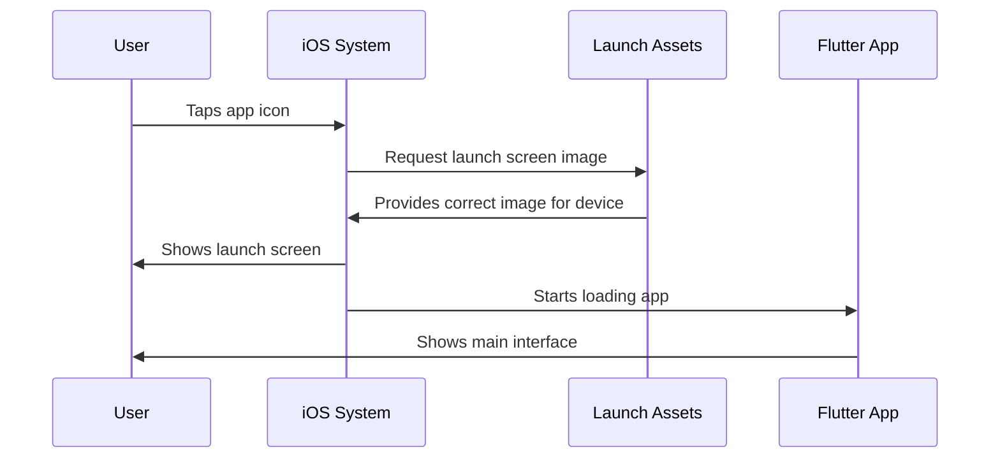
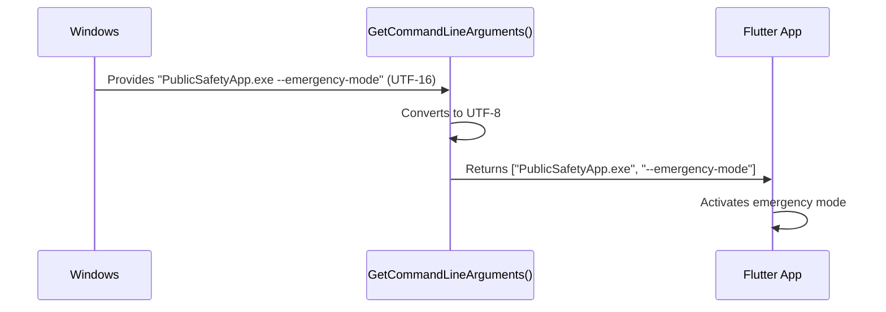

# Chapter 1: Platform-Specific Utilities and Resources

Welcome to the Public Safety Application tutorial! In this first chapter, we'll explore the foundational elements that make your app look good and work properly on different devices like iPhones, Android phones, and Windows computers.

## What Problem Are We Solving?

Imagine you're building a house that needs to work in three different countries. Each country has different electrical outlets, different door sizes, and different weather conditions. You can't just build one house and expect it to work perfectly everywhere - you need special adapters, decorations, and tools specific to each location.

The same is true for mobile and desktop apps! An iPhone needs different image files and resources than a Windows computer. Our Public Safety Application needs to run on multiple platforms (iOS, Android, Windows, etc.), and each platform has its own requirements.

**Our Central Use Case:** When a user opens our Public Safety Application on their iPhone, they should see a nice launch screen with the app's logo while the app loads. On Windows, the app needs proper icons and should handle text correctly. Each platform needs its own "toolbox" of resources and helper functions.

## Key Concepts

Let's break this down into three simple concepts:

### 1. Launch Screen Assets (The First Impression)

Think of launch screen assets as the "welcome mat" of your app. When someone taps your app icon, they don't see the full app immediately - it takes a second or two to load. During that time, we show them a nice image called a "launch screen" or "splash screen."

Each platform (iOS, Android, Windows) needs these images in specific sizes and formats. On iOS, these images are stored in special folders with specific naming conventions.

Here's what the iOS launch screen folder structure looks like:

```
ios/Runner/Assets.xcassets/
    └── LaunchImage.imageset/
        ├── LaunchImage.png
        ├── LaunchImage@2x.png
        ├── LaunchImage@3x.png
        └── README.md
```

**Why multiple images?** Different iPhones have different screen resolutions (standard, retina, super retina). The `@2x` and `@3x` versions are for higher resolution screens, ensuring your launch screen looks crisp on every device.

### 2. Resource Definitions (The ID Cards)

Every visual element in your app needs an "ID card" so the platform knows what it is. On Windows, this is handled through resource files.

Here's a simple example from our Windows resource header:

```cpp
// resource.h
#define IDI_APP_ICON  101
```

**What does this mean?** This line creates a unique identifier (the number `101`) for our app icon. When Windows needs to show your app's icon in the taskbar or title bar, it looks up `IDI_APP_ICON` and knows to use resource number `101`.

Think of it like a library card catalog - instead of searching for "that app icon," Windows can quickly look up resource `101`.

### 3. Utility Functions (The Helper Tools)

Different platforms handle text and commands differently. Windows, for example, uses a text encoding called UTF-16, while most modern systems use UTF-8. Utility functions help translate between these formats.

Here's a glimpse of what utilities we need on Windows:

```cpp
// utils.h
std::string Utf8FromUtf16(const wchar_t* utf16_string);
```

**What does this do?** This function takes text in Windows' preferred format (UTF-16) and converts it to UTF-8, which our Flutter app understands. It's like having a translator who helps two people speaking different languages communicate.

## How These Pieces Work Together

Let's trace what happens when a user opens our Public Safety Application on iOS:



**Step-by-step breakdown:**

1. **User taps the app icon** - They want to use the Public Safety Application
2. **iOS immediately looks for launch assets** - Before anything else loads
3. **The correct image is selected** - Based on the device's screen resolution
4. **User sees the launch screen** - They know the app is loading
5. **The Flutter app loads in the background** - While they're looking at the pretty launch screen
6. **Main app interface appears** - The launch screen fades away

## Looking Under the Hood: iOS Launch Assets

Let's dive deeper into how iOS handles launch screen assets. When you build your app, Xcode (Apple's development tool) looks in the `Assets.xcassets` folder:

```
Assets.xcassets/
    └── LaunchImage.imageset/
```

Inside this folder, there's a special file called `Contents.json` (not shown in our snippets) that tells iOS:
- Which image file to use for which device
- What scale factor each image represents
- How to display the images

**You can customize these images!** According to the README file in our project:

```markdown
# Launch Screen Assets

You can customize the launch screen with your own 
desired assets by replacing the image files in 
this directory.
```

Simply replace the PNG files with your own images (keeping the same names), and your app will show your custom launch screen!

## Looking Under the Hood: Windows Resources

On Windows, the resource system works differently. Let's examine the `resource.h` file:

```cpp
#define IDI_APP_ICON  101
```

This is a C++ preprocessor directive. Think of `#define` as creating a nickname. Whenever the code says `IDI_APP_ICON`, it actually means `101`.

The full resource file also includes these lines:

```cpp
#ifdef APSTUDIO_INVOKED
#define _APS_NEXT_RESOURCE_VALUE  102
#endif
```

**What's happening here?** This keeps track of the next available resource number. If you add a new icon or image, it would get number `102`, then `103`, and so on. This prevents conflicts where two resources accidentally share the same number.

## Looking Under the Hood: Windows Utilities

The Windows utility functions solve practical problems. Let's look at the command-line argument helper:

```cpp
std::vector<std::string> GetCommandLineArguments();
```

**Why do we need this?** When someone launches your app from a command prompt or a script, they might pass extra information:

```
PublicSafetyApp.exe --emergency-mode
```

This utility function:
1. Retrieves the command-line arguments from Windows
2. Converts them from UTF-16 to UTF-8
3. Returns them as a list of text strings your app can understand

**Example flow:**



## Practical Example: Adding a Custom Launch Screen

Let's walk through customizing the iOS launch screen for our Public Safety Application:

**Step 1:** Create your launch screen image (e.g., an image with your app logo)

**Step 2:** Generate three sizes:
- `LaunchImage.png` - 1x resolution (e.g., 300x300 pixels)
- `LaunchImage@2x.png` - 2x resolution (600x600 pixels)
- `LaunchImage@3x.png` - 3x resolution (900x900 pixels)

**Step 3:** Replace the files in this folder:
```
ios/Runner/Assets.xcassets/LaunchImage.imageset/
```

**Result:** Next time someone opens your app on iOS, they'll see your custom launch screen!

## Why Platform-Specific Resources Matter

You might wonder: "Why can't we just use one set of resources for all platforms?"

Here's the reality:
- **iOS** expects images in `.xcassets` folders with specific naming
- **Android** uses different folders like `res/drawable`
- **Windows** uses `.rc` resource files with numerical IDs
- **Each platform** has its own text encoding and system calls

These platform-specific utilities and resources are like having the right adapter plug when you travel - they make your app work correctly in each environment.

## Summary

In this chapter, you learned:

✅ **Launch screen assets** provide the first visual impression of your app on each platform  
✅ **Resource definitions** give unique IDs to visual elements like icons  
✅ **Utility functions** help translate between different text formats and system requirements  
✅ **Each platform needs its own toolbox** of resources and helpers  

These utilities and resources don't contain the main logic of your app - they're the foundation that makes your app presentable and functional on each platform.

In the next chapter, [Platform Plugin Registration](02_platform_plugin_registration_.md), we'll explore how your app connects to platform-specific features like cameras, GPS, and notifications - the bridges that let your Flutter app talk to iOS, Android, and Windows features!

