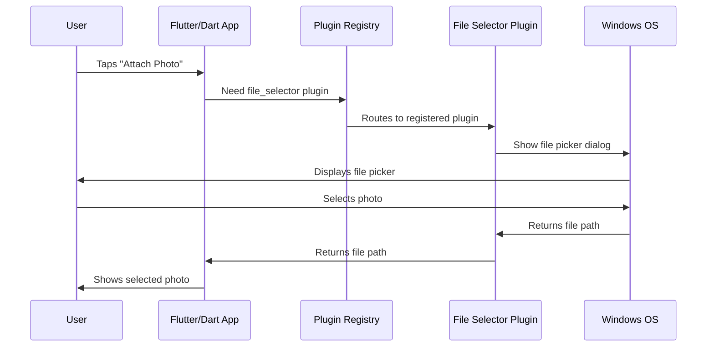
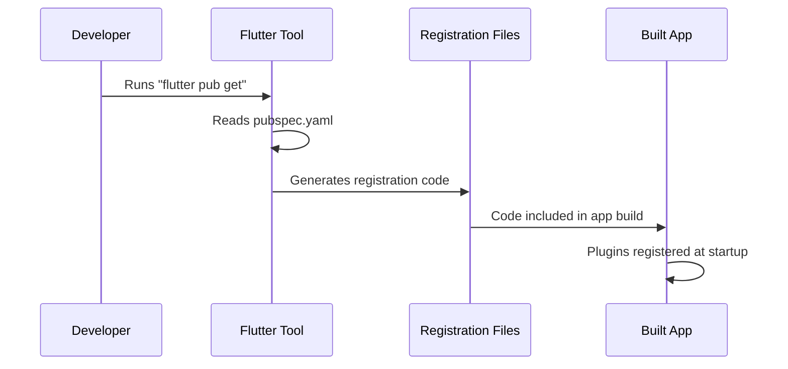
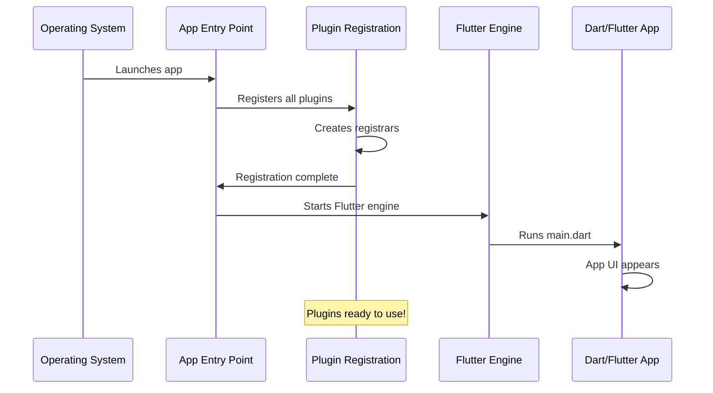

# Chapter 2: Platform Plugin Registration

In [Chapter 1: Platform-Specific Utilities and Resources](01_platform_specific_utilities_and_resources_.md), we learned how each platform (iOS, Windows, Linux) needs its own special resources—like having the right adapter plugs for different countries. Now we'll explore how our Flutter app actually *uses* those platform-specific features.

## What Problem Are We Solving?

Imagine you're building a Public Safety Application that needs to:
- Let users **pick a photo** from their device to attach to an incident report
- **Open a web link** to view safety guidelines in their browser

Here's the challenge: Flutter (the framework we're using) is written in the Dart programming language, which runs the same way on all devices. But **picking files** and **opening URLs** require talking directly to the operating system—and each operating system (iOS, Windows, Linux, Android) has completely different ways of doing these tasks!

**Our Central Use Case:** When a user taps "Attach Photo" in our Public Safety Application on Windows, the app needs to:
1. Pause the Flutter/Dart code
2. Ask Windows to show its native file picker dialog
3. Get the selected file back
4. Return control to Flutter/Dart

This "asking the platform to do something" is what **plugins** handle. But how does Flutter know which native code to call? That's where **Platform Plugin Registration** comes in—it's like a phone directory that connects Flutter's requests to the right platform-specific code.

## Key Concepts

Let's break down Platform Plugin Registration into simple pieces:

### 1. What is a Plugin?

A **plugin** is a bridge between your Flutter/Dart code and the native platform code.

Think of it like a translator at the United Nations:
- Flutter speaks "Dart" (the same language everywhere)
- iOS speaks "Objective-C/Swift"
- Windows speaks "C++"
- Linux speaks "C/GTK"

The plugin is the translator who helps them communicate!

**Example:** The `file_selector` plugin lets your Dart code say "I need to pick a file," and the plugin translates that request into the native file picker for whatever platform you're on.

### 2. What is Plugin Registration?

**Plugin Registration** is the process of telling the platform: "Hey! These plugins are available. When Flutter asks for them, here's where to find them."

It's like registering attendees at a conference. Before the event starts, you create a list:
- "If someone asks for the File Selector Plugin, send them to Room 101"
- "If someone asks for the URL Launcher Plugin, send them to Room 102"

This registration happens automatically when your app starts, before any Flutter code runs.

### 3. Platform-Specific Registration

Here's the tricky part: **each platform registers plugins differently** because they use different programming languages and systems.

- **Linux** uses C/GTK and registers plugins with `fl_register_plugins()`
- **Windows** uses C++ and registers plugins with `RegisterPlugins()`
- **iOS** uses Objective-C/Swift and has its own registration system

But don't worry! Flutter generates all this registration code automatically. You rarely need to modify it.

## How Plugin Registration Solves Our Use Case

Let's trace what happens when a user taps "Attach Photo" in our app on **Windows**:



**Step-by-step breakdown:**

1. **User taps "Attach Photo"** - They want to add evidence to their incident report
2. **Flutter asks the Registry** - "I need the file_selector plugin"
3. **Registry routes to the plugin** - "Here's where the file_selector code lives"
4. **Plugin talks to Windows** - Uses native C++ code to open Windows file picker
5. **User selects a photo** - Browses their Pictures folder
6. **Windows returns the path** - "C:\Users\John\Pictures\evidence.jpg"
7. **Plugin translates back to Flutter** - Converts C++ data to Dart
8. **Flutter shows the photo** - Displays it in the app

**The key insight:** The Registry made step 3 possible. Without registration, Flutter wouldn't know where to find the file_selector plugin code for Windows!

## Looking Under the Hood: Linux Plugin Registration

Let's examine how Linux registers its plugins. Here's the main registration function:

```cpp
void fl_register_plugins(FlPluginRegistry* registry) {
  // Registration code here
}
```

**What's happening?** This function is called once when your app starts on Linux. The `FlPluginRegistry* registry` is like a guest book where plugins sign in.

Now let's see how individual plugins register:

```cpp
g_autoptr(FlPluginRegistrar) file_selector_linux_registrar =
    fl_plugin_registry_get_registrar_for_plugin(
        registry, "FileSelectorPlugin");
```

**Breaking this down:**
- `g_autoptr` - Automatic memory management (don't worry about the details)
- `FlPluginRegistrar` - A "registration form" for one plugin
- `fl_plugin_registry_get_registrar_for_plugin()` - "Get me a registration form"
- `"FileSelectorPlugin"` - The name of the plugin we're registering

Think of this like getting a name tag at a conference. You go to the registration desk and say, "I'm FileSelectorPlugin," and they give you a name tag (the registrar).

Next, the plugin actually signs in:

```cpp
file_selector_plugin_register_with_registrar(
    file_selector_linux_registrar);
```

This line says: "Use this registration form to officially sign in the file_selector plugin." Now the registry knows this plugin exists!

## Looking Under the Hood: Complete Linux Registration

Here's the full Linux registration file (simplified):

```cpp
void fl_register_plugins(FlPluginRegistry* registry) {
  // Register file selector plugin
  g_autoptr(FlPluginRegistrar) file_selector_registrar =
      fl_plugin_registry_get_registrar_for_plugin(
          registry, "FileSelectorPlugin");
  file_selector_plugin_register_with_registrar(
      file_selector_registrar);
      
  // Register URL launcher plugin
  g_autoptr(FlPluginRegistrar) url_launcher_registrar =
      fl_plugin_registry_get_registrar_for_plugin(
          registry, "UrlLauncherPlugin");
  url_launcher_plugin_register_with_registrar(
      url_launcher_registrar);
}
```

**What's happening here?**
1. The function registers **two plugins**: file_selector and url_launcher
2. Each plugin gets its own "registration form" (registrar)
3. Each plugin officially signs in
4. The registry now knows about both plugins

**Why two separate plugins?** Each plugin handles one specific task:
- `file_selector` - Picking files from the device
- `url_launcher` - Opening web links or external apps

In our Public Safety Application:
- Use `file_selector` when users attach photos to reports
- Use `url_launcher` when users tap "View Safety Guidelines" to open a website

## Looking Under the Hood: Windows Plugin Registration

Windows uses a similar pattern but with C++ syntax. Here's the header file:

```cpp
#ifndef GENERATED_PLUGIN_REGISTRANT_
#define GENERATED_PLUGIN_REGISTRANT_

void RegisterPlugins(flutter::PluginRegistry* registry);

#endif
```

**What does this mean?**
- `#ifndef` / `#define` / `#endif` - Guard against including this file multiple times (technical detail you can ignore)
- `void RegisterPlugins(...)` - This declares the function that registers all Windows plugins
- `flutter::PluginRegistry* registry` - The Windows version of the plugin guest book

**The pattern is the same:**
1. There's a registry (guest book)
2. There's a registration function
3. Plugins sign in when the app starts

The only difference is the syntax—Linux uses `fl_register_plugins`, Windows uses `RegisterPlugins`. But they're doing the same job!

## Looking Under the Hood: iOS Plugin Registration

iOS takes a slightly different approach. Look at this header file:

```objc
#import "GeneratedPluginRegistrant.h"
```

**What's this doing?** The `#import` statement is like saying "include the iOS plugin registry code here." 

iOS uses a pre-built registration system called `GeneratedPluginRegistrant`. You don't see the registration code directly because Flutter generates it automatically and compiles it into your app.

**Why is iOS different?** iOS apps are typically written in Objective-C or Swift, which handle imports differently than C/C++. But the concept is identical—iOS still has a registry that connects Flutter to native iOS plugins.

## What "Generated File" Means

You might have noticed this comment at the top of the files:

```cpp
//
//  Generated file. Do not edit.
//
```

**What does "generated" mean?** When you add a plugin to your Flutter project (by editing `pubspec.yaml`), Flutter automatically creates these registration files. 

**The workflow:**



**Step-by-step:**
1. **You add a plugin** to `pubspec.yaml` (e.g., `file_selector: ^0.9.0`)
2. **You run `flutter pub get`** to download the plugin
3. **Flutter automatically generates** the registration files for each platform
4. **The registration code is included** when you build your app
5. **When your app starts**, plugins are automatically registered

**Important:** Never manually edit these generated files! If you add or remove a plugin, Flutter will regenerate them. Any manual changes would be lost.

## Practical Example: Using Registered Plugins

Now that plugins are registered, how do you use them in your Dart code? Here's a simple example of using the file_selector plugin:

```dart
import 'package:file_selector/file_selector.dart';

// When user taps "Attach Photo"
final file = await openFile();
```

**What happens behind the scenes:**

1. **Dart code calls `openFile()`** - Your Flutter app makes the request
2. **Flutter looks up `file_selector` in the registry** - "Which plugin handles file selection?"
3. **Registry returns the file_selector plugin** - "Here it is, already registered!"
4. **Plugin calls native platform code** - Windows/Linux/iOS file picker opens
5. **User selects a file** - Native dialog handles the interaction
6. **Path returns to Dart** - `file` variable now contains the selected file

**The beauty:** You write one line of Dart code (`openFile()`), and it works on Windows, Linux, iOS, Android, and more! The registration system handles all the platform-specific routing.

## Why Automatic Registration Matters

You might wonder: "Why not just manually list which plugins I want?"

**Three big benefits of automatic registration:**

1. **No human error** - You can't forget to register a plugin or misspell its name
2. **Stays synchronized** - When you add/remove plugins from `pubspec.yaml`, registration updates automatically
3. **Platform-optimized** - Flutter generates the most efficient registration code for each platform

**Example scenario:** You add the `camera` plugin to your Public Safety Application for taking incident photos. Here's what happens:

```
You add to pubspec.yaml:
  camera: ^0.10.0

You run:
  flutter pub get

Flutter automatically:
  ✅ Updates Linux registration file
  ✅ Updates Windows registration file  
  ✅ Updates iOS registration file
  ✅ Updates Android registration file
```

No manual work required! The camera plugin is now registered and ready to use on all platforms.

## The Registrar Object Explained

Let's dive deeper into what a "registrar" actually is. Look at this line again:

```cpp
FlPluginRegistrar* file_selector_linux_registrar =
    fl_plugin_registry_get_registrar_for_plugin(
        registry, "FileSelectorPlugin");
```

**What is a registrar?** Think of it as a **dedicated service desk** for one specific plugin. 

The registrar provides:
- A way for the plugin to communicate with Flutter
- Access to platform-specific resources
- A "mailbox" for messages between Dart and native code

**Analogy:** Imagine a hotel:
- The **registry** is the main reception desk
- Each **registrar** is a concierge assigned to one guest (plugin)
- The **plugin** is the guest who needs assistance

When the file_selector plugin needs to show a file picker, it asks its registrar, "Please show the native file dialog." The registrar has direct access to the operating system, so it makes it happen.

## Header Files vs Implementation Files

You might notice there are two types of files:

**Header files** (`.h` extension):
```cpp
// generated_plugin_registrant.h
void fl_register_plugins(FlPluginRegistry* registry);
```

**Implementation files** (`.cc` or `.cpp` extension):
```cpp
// generated_plugin_registrant.cc
void fl_register_plugins(FlPluginRegistry* registry) {
  // Actual registration code here
}
```

**What's the difference?**

- **Header files** are like a table of contents—they declare what functions exist
- **Implementation files** contain the actual code that does the work

**Why separate them?** This is a C/C++ convention that allows other parts of your app to see what functions are available (by reading the header) without needing to know how they work (which is in the implementation).

## Platform Plugin Registration in the Big Picture

Let's see where plugin registration fits in the overall app lifecycle:



**The complete startup sequence:**

1. **Operating system launches your app** - User tapped the icon
2. **App entry point runs first** - Platform-specific startup code (we'll learn about this in [Chapter 3: Platform Application Entry Points](03_platform_application_entry_points_.md))
3. **Plugin registration happens** - All plugins are registered before anything else
4. **Flutter engine starts** - The framework initializes
5. **Your Dart code runs** - Your main.dart and app UI appear
6. **Plugins are ready** - Now your app can use file_selector, url_launcher, etc.

**Key point:** Registration happens very early, before your app's UI even appears. This ensures plugins are always available when your Dart code needs them.

## Common Plugins in Public Safety Applications

Let's explore which registered plugins you might use in a Public Safety Application:

**file_selector** - Registered on Linux and Windows (as we saw in the code)
- Use case: Attach photos, documents, or evidence to incident reports
- Example: User reports a pothole and attaches a photo

**url_launcher** - Registered on Linux and Windows
- Use case: Open external links to emergency resources, maps, or guidelines
- Example: User taps "Call 911" and the phone app opens

**Other common plugins** (would also be registered if added):
- `camera` - Take photos directly in the app
- `geolocator` - Get user's location for incident reports
- `shared_preferences` - Save user settings and preferences

Each of these plugins would appear in the registration files once you add them to your project!

## Summary

In this chapter, you learned:

✅ **Plugins are bridges** between Flutter/Dart and native platform features  
✅ **Plugin registration** is like a phone directory connecting Flutter to platform-specific code  
✅ **Each platform registers plugins differently** (Linux, Windows, iOS use different syntax)  
✅ **Registration happens automatically** when you add plugins to pubspec.yaml  
✅ **Registration occurs at startup** before your Flutter app's UI appears  
✅ **You should never edit** generated registration files manually  

Plugin registration is the invisible infrastructure that makes cross-platform development possible. You write Dart code once, and the registration system ensures it works on every platform by routing requests to the correct native implementation.

In the next chapter, [Platform Application Entry Points](03_platform_application_entry_points_.md), we'll explore where your app actually *begins* on each platform—the very first code that runs when a user launches your Public Safety Application. This is where the registration system we just learned about gets called!

