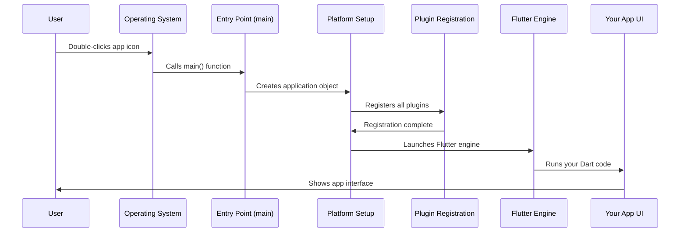
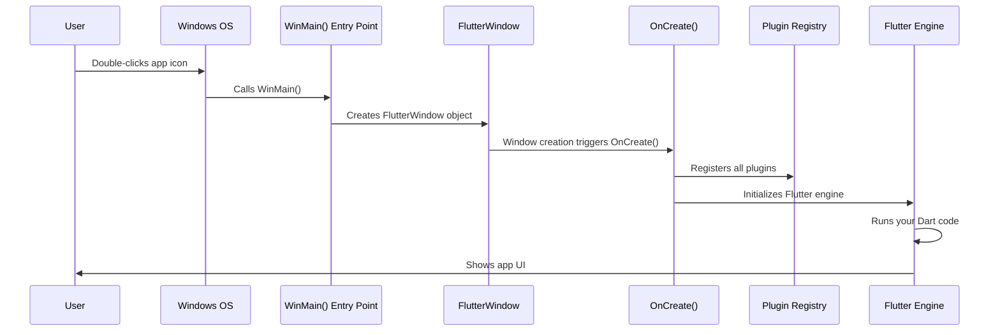
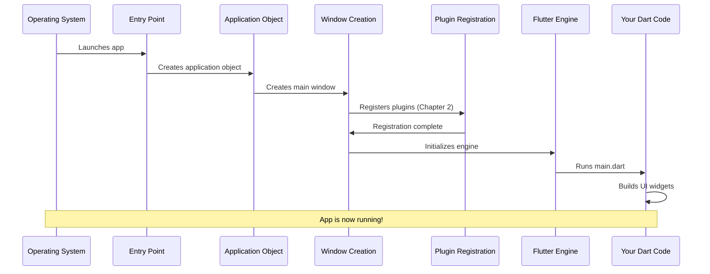

# Chapter 3: Platform Application Entry Points

In [Chapter 2: Platform Plugin Registration](02_platform_plugin_registration_.md), we learned how Flutter connects to platform-specific features like file pickers and URL launchers through a registry system. But there's an important question we haven't answered yet: **Where does this registration actually happen? What's the very first code that runs when a user launches your app?**

## What Problem Are We Solving?

Imagine you're organizing a conference. Before attendees arrive, someone needs to:
- Unlock the doors
- Turn on the lights
- Set up the registration desk
- Make sure the microphones work

The conference can't start until all these preparations are done. Similarly, before your Flutter app can run, someone needs to:
- Start the operating system's application framework
- Register all the plugins (like we learned in Chapter 2)
- Launch the Flutter engine
- Show the first screen

**Our Central Use Case:** When a user on Linux double-clicks the Public Safety Application icon, what happens in the first milliseconds? What code runs before the Flutter app's main screen appears?

The answer is: **Platform Application Entry Points**. These are special files containing the "main door" where the operating system enters your application. Like how every building has a main entrance, every application needs an entry point where execution begins.

## Key Concepts

Let's break down Platform Application Entry Points into digestible pieces:

### 1. What is an Entry Point?

An **entry point** is the very first function the operating system calls when launching your app.

Think of it like a relay race:
- **The OS** is the first runner holding the baton (your app)
- **The entry point** is where the OS hands off the baton
- **Your app** takes the baton and runs with it

Every programming language has a conventional entry point:
- In C and C++, it's a function called `main()`
- In Python, it's the code at the top level of your script
- In Java, it's `public static void main()`

**Example:** When you double-click an app icon on Linux, the operating system looks for the `main()` function and starts running code from there.

### 2. Why Different Entry Points for Each Platform?

Remember from [Chapter 1: Platform-Specific Utilities and Resources](01_platform_specific_utilities_and_resources_.md) that each platform speaks a different "language":
- **Linux** uses GTK (a graphical toolkit) and C
- **Windows** uses Win32 API and C++
- **iOS** uses UIKit and Objective-C/Swift

Each platform expects its applications to start in a specific way:
- Linux expects a GTK application object
- Windows expects a window with a message loop
- iOS expects an app delegate

That's why we have different entry point files for each platform!

### 3. The Journey from Entry Point to Flutter

Here's what happens from the moment a user launches your app until they see your Flutter UI:



**Step-by-step breakdown:**

1. **User double-clicks the app icon** - They want to open the Public Safety Application
2. **OS finds the entry point** - Locates the `main()` function
3. **Entry point creates platform setup** - Initializes GTK on Linux, Win32 on Windows, etc.
4. **Platform registers plugins** - Calls the registration code we learned about in Chapter 2
5. **Flutter engine launches** - The framework that runs your Dart code starts up
6. **Your app UI appears** - The main.dart file runs and shows the interface
7. **User sees the app** - Everything is ready!

**The key insight:** The entry point kicks off a chain reaction that eventually leads to your Flutter app running. It's the very first domino that falls!

## Looking Under the Hood: Linux Entry Point

Let's examine the Linux entry point. This is the simplest entry point to understand, so we'll start here.

**File:** `linux/main.cc`

```cpp
#include "my_application.h"

int main(int argc, char** argv) {
```

**What's happening?**
- `#include "my_application.h"` - Brings in the code for our application object
- `int main(int argc, char** argv)` - The entry point function!
  - `int` - Returns a number (0 means success, non-zero means error)
  - `main` - The standard entry point name in C/C++
  - `argc` - Count of command-line arguments
  - `argv` - Array of command-line arguments (e.g., `["app_name", "--debug"]`)

**Real-world analogy:** This is like the front door of your house. When someone arrives (the OS launches your app), this is where they enter.

Now let's see what happens inside:

```cpp
  g_autoptr(MyApplication) app = my_application_new();
```

**Breaking this down:**
- `g_autoptr(MyApplication)` - Creates a smart pointer that automatically cleans up memory (don't worry about the details)
- `app` - Variable name for our application object
- `my_application_new()` - Creates a new GTK application

**Analogy:** This is like turning on the lights and power in the building. We're creating the framework that will hold everything else.

Finally, we actually run the application:

```cpp
  return g_application_run(G_APPLICATION(app), argc, argv);
}
```

**What's happening:**
- `g_application_run()` - Starts the GTK application's main loop
- `G_APPLICATION(app)` - Converts our app to a GTK application object
- `argc, argv` - Passes any command-line arguments to the app
- `return` - Sends the exit code back to the OS when the app closes

**What is a "main loop"?** It's an infinite loop that keeps the app running, constantly checking for:
- Mouse clicks
- Keyboard input
- Window resize events
- Timer events

Without this loop, your app would start and immediately exit!

## The Complete Linux Entry Point

Here's the full Linux entry point with annotations:

```cpp
#include "my_application.h"  // Brings in our app definition

// Entry point - OS calls this first
int main(int argc, char** argv) {
  // Create the application object
  g_autoptr(MyApplication) app = my_application_new();
  
  // Run the app (starts event loop, registers plugins, launches Flutter)
  return g_application_run(G_APPLICATION(app), argc, argv);
}
```

**That's it!** Only 4 meaningful lines of code. The real work happens inside `my_application_new()` and `g_application_run()`.

**What happens inside these functions?**

Inside `my_application_new()`:
1. Creates a GTK application object
2. Sets up the application ID (like "com.example.public_safety")
3. Prepares to create windows

Inside `g_application_run()`:
1. **Registers plugins** (calls `fl_register_plugins()` from Chapter 2)
2. Creates the main window
3. Initializes the Flutter engine
4. Starts the event loop
5. Runs your Flutter/Dart code

## Looking Under the Hood: The Linux Application Header

Let's look at what `MyApplication` actually is:

**File:** `linux/my_application.h`

```cpp
#ifndef FLUTTER_MY_APPLICATION_H_
#define FLUTTER_MY_APPLICATION_H_
```

**What's this?** These are "header guards" that prevent including this file multiple times. Think of it as a lock that says "only read this once."

```cpp
#include <gtk/gtk.h>
```

**What's this?** This brings in the GTK library - the graphical toolkit that creates windows, buttons, and other UI elements on Linux.

Now the important part:

```cpp
G_DECLARE_FINAL_TYPE(MyApplication, my_application, MY, APPLICATION,
                     GtkApplication)
```

**What does this do?** This is GTK magic that declares a new type of application object called `MyApplication`. It's based on `GtkApplication`, which is GTK's standard application class.

**Analogy:** Think of this like declaring a new type of car. GTK provides a base "Car" class with engine, wheels, etc. We're declaring "MyApplication" as a specialized car (maybe a police car for our Public Safety app) that has all the standard car features plus some custom additions.

Finally, there's the constructor:

```cpp
MyApplication* my_application_new();
```

**What's this?** This declares the function that creates a new instance of our application. It's what we called in `main()` earlier!

```cpp
#endif  // FLUTTER_MY_APPLICATION_H_
```

This closes the header guard we opened at the top.

## Looking Under the Hood: Windows Entry Point

Windows has a more complex entry point because it needs to manage windows and message loops. Let's look at the key file:

**File:** `windows/runner/flutter_window.h`

```cpp
#ifndef RUNNER_FLUTTER_WINDOW_H_
#define RUNNER_FLUTTER_WINDOW_H_
```

Again, header guards to prevent multiple includes.

```cpp
#include <flutter/dart_project.h>
#include <flutter/flutter_view_controller.h>
```

**What's this?** Importing Flutter-specific code:
- `dart_project.h` - Defines the Flutter/Dart project configuration
- `flutter_view_controller.h` - Manages the Flutter view (where your UI appears)

```cpp
#include "win32_window.h"
```

**What's this?** Brings in Windows-specific window creation code. `Win32` is the name of the Windows API.

Now the class declaration:

```cpp
class FlutterWindow : public Win32Window {
```

**What's this?** Declares a class called `FlutterWindow` that inherits from `Win32Window`.

**Analogy:** Think of `Win32Window` as a basic picture frame. `FlutterWindow` is a special frame that can display Flutter content. It has all the features of a regular frame (border, title bar, close button) plus the ability to show Flutter UI inside.

## The FlutterWindow Class Structure

Let's look at the key parts of the FlutterWindow class:

```cpp
 public:
  explicit FlutterWindow(const flutter::DartProject& project);
  virtual ~FlutterWindow();
```

**What's this?**
- `FlutterWindow(...)` - Constructor that creates a new window
- `const flutter::DartProject& project` - Takes the Flutter project configuration
- `~FlutterWindow()` - Destructor that cleans up when the window closes

**Analogy:** The constructor is like building the window frame, and the destructor is like taking it down when you're done.

Now the important methods:

```cpp
 protected:
  bool OnCreate() override;
  void OnDestroy() override;
```

**What are these?**
- `OnCreate()` - Called when the window is first created (before it's visible)
- `OnDestroy()` - Called when the window is being closed

**This is where the magic happens!** Inside `OnCreate()`:
1. The Flutter engine is initialized
2. Plugins are registered (calls `RegisterPlugins()` from Chapter 2)
3. Your Flutter/Dart code starts running

```cpp
  LRESULT MessageHandler(HWND window, UINT const message, 
                         WPARAM const wparam, LPARAM const lparam) noexcept override;
```

**What's this?** The message handler processes Windows events like:
- Mouse clicks
- Keyboard presses
- Window resize
- Window close

**Analogy:** This is like a receptionist who receives messages and directs them to the right place. Windows sends messages, and this function decides what to do with them.

Finally, the private members:

```cpp
 private:
  flutter::DartProject project_;
  std::unique_ptr<flutter::FlutterViewController> flutter_controller_;
};
```

**What's this?**
- `project_` - Stores the Flutter project configuration
- `flutter_controller_` - Manages the actual Flutter view where your UI renders

**Analogy:** The `project_` is like the blueprint for your app, and the `flutter_controller_` is like the construction crew that builds it based on the blueprint.

## How Windows Entry Point Works

Here's what happens when a user launches your app on Windows:



**Step-by-step breakdown:**

1. **User double-clicks** - Launches the Public Safety Application
2. **Windows calls WinMain()** - This is Windows' entry point (like `main()` on Linux)
3. **WinMain creates FlutterWindow** - Constructs the window object
4. **OnCreate() is called** - Windows triggers this when the window is being created
5. **OnCreate() registers plugins** - Calls the code from Chapter 2
6. **OnCreate() starts Flutter** - Initializes the Flutter engine
7. **Flutter runs your Dart code** - Your app's main.dart executes
8. **UI appears** - User sees the interface

**Key difference from Linux:** On Windows, the entry point (`WinMain`) isn't shown in our snippets because it's in a different file. But it follows the same pattern: create the application object, then run it.

## Why the Entry Points Look Different

You might wonder: "Why is the Linux entry point a simple `main()` function, but Windows uses a complex `FlutterWindow` class?"

**The answer:** Each operating system has different requirements:

**Linux with GTK:**
- GTK provides a high-level application framework
- You create an application object and call `g_application_run()`
- GTK handles most of the complexity for you

**Windows with Win32:**
- Win32 is a lower-level API
- You need to manually create windows, handle messages, and manage the event loop
- More code is needed to set up the environment

**Both accomplish the same goal:** Create a window, register plugins, launch Flutter, and show your UI. The code just looks different because the underlying platforms are different!

## The Role of Entry Points in Your App's Lifecycle

Let's see the complete lifecycle from entry point to running app:



**Timeline:**

1. **0ms** - User clicks icon
2. **1ms** - OS loads app into memory
3. **2ms** - Entry point (main) starts
4. **5ms** - Application object created
5. **10ms** - Window created
6. **15ms** - Plugins registered (from Chapter 2)
7. **20ms** - Flutter engine initialized
8. **50ms** - Your Dart code runs
9. **100ms** - User sees the UI

(These times are approximate and vary by device)

**The entry point happens at step 3** - very early in the process! It sets everything else in motion.

## Practical Example: Command-Line Arguments

One useful feature of entry points is handling command-line arguments. Remember this from the Linux entry point?

```cpp
int main(int argc, char** argv) {
```

**What are argc and argv?**
- `argc` - "argument count" - how many arguments were passed
- `argv` - "argument vector" - an array of the actual arguments

**Example:** If someone launches your app like this:

```bash
./public_safety_app --emergency-mode --location=hospital
```

Then:
- `argc` would be `3` (the app name counts as the first argument)
- `argv[0]` would be `"./public_safety_app"`
- `argv[1]` would be `"--emergency-mode"`
- `argv[2]` would be `"--location=hospital"`

**Use case:** You could check for an emergency mode flag and immediately show the emergency interface:

```cpp
int main(int argc, char** argv) {
  // Check if emergency mode was requested
  bool emergency_mode = false;
  for (int i = 1; i < argc; i++) {
    if (strcmp(argv[i], "--emergency-mode") == 0) {
      emergency_mode = true;
    }
  }
  
  // Create app and pass emergency flag
  g_autoptr(MyApplication) app = my_application_new();
  // ... configure emergency mode ...
  return g_application_run(G_APPLICATION(app), argc, argv);
}
```

**Note:** In practice, Flutter apps typically handle command-line arguments in Dart code, but the entry point receives them first!

## What Happens Without an Entry Point?

You might wonder: "What if I deleted the entry point file?"

**The result:** Your app wouldn't run at all!

Here's what would happen:

1. You build the app: ✅ (Compilation would succeed)
2. User clicks the icon: ⚠️
3. OS looks for the entry point: ❌ (Not found!)
4. OS shows an error: "Cannot execute file"

**Analogy:** It's like having a house with no door. The house exists, but there's no way to enter it!

The entry point is mandatory - every application must have exactly one.

## Entry Points Are Like "Main Doors"

Throughout this chapter, we've used the "main door" analogy. Let's make it concrete:

**A building has:**
- A main entrance (entry point)
- A reception desk (application object)
- Elevators and hallways (plugin registry)
- Individual offices (Flutter widgets)
- People working inside (your Dart code)

**When someone arrives:**
1. They enter through the main door (entry point runs)
2. They check in at reception (application object created)
3. They take the elevator to the right floor (plugins registered)
4. They reach their office (Flutter engine starts)
5. They begin working (your Dart code runs)

**Without the main door**, no one can enter, and the building is useless - even if everything inside is perfect!

## Summary

In this chapter, you learned:

✅ **Entry points are the first code that runs** when your app launches  
✅ **Each platform has its own entry point** (Linux uses `main()`, Windows uses `WinMain`)  
✅ **Entry points create the application object** that manages everything else  
✅ **The entry point kicks off a chain:** Application → Window → Plugins → Flutter → Your Code  
✅ **Entry points can handle command-line arguments** for advanced use cases  
✅ **Without an entry point, your app can't run** - it's the mandatory "main door"  

Platform application entry points are the foundation of your app's architecture. They're the bridge between the operating system and your Flutter code. While you rarely need to modify entry point files, understanding them helps you see the complete picture of how your app starts and runs.

**The complete journey from user to UI:**

1. **Chapter 1:** [Platform-Specific Utilities and Resources](01_platform_specific_utilities_and_resources_.md) - The images, icons, and helper functions each platform needs
2. **Chapter 2:** [Platform Plugin Registration](02_platform_plugin_registration_.md) - How Flutter connects to native features like file pickers
3. **Chapter 3:** Platform Application Entry Points (this chapter) - Where execution begins and how the app launches

You now understand the full path from the moment a user clicks your Public Safety Application icon to the moment they see the interface! Each platform has its own way of starting (the entry point), but they all eventually launch the same Flutter application code that you write in Dart.

