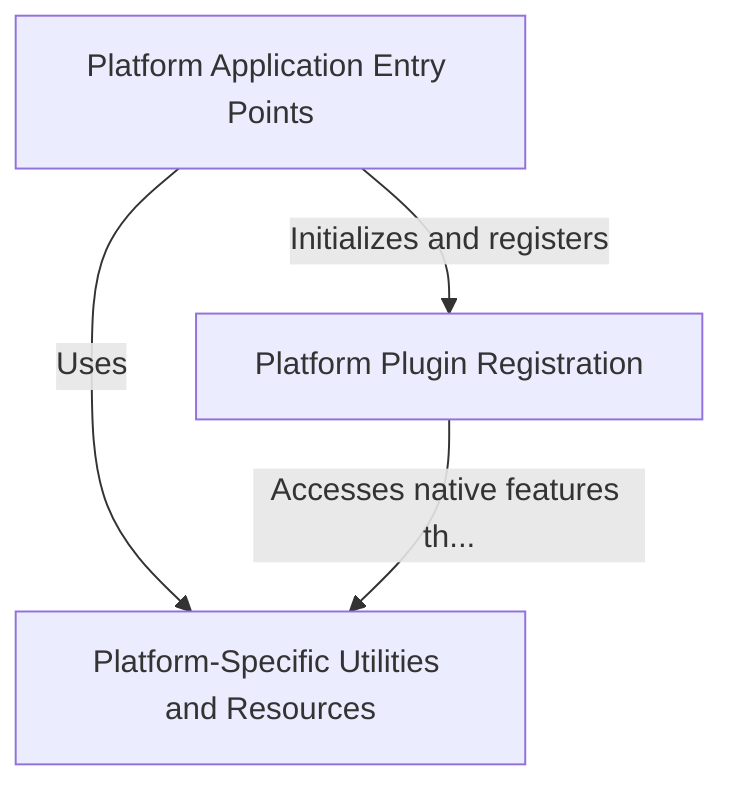

# Tutorial: Public_Safety_Application

This is a **Public Safety Application** built with Flutter that can run on multiple platforms (iOS, Linux, and Windows). 
The project is structured to handle *platform-specific code* that connects Flutter's Dart code to each operating system's 
native features. Think of it as a **cross-platform app** where the same Flutter code runs everywhere, but each platform 
needs its own "adapter" to handle things like *file selection* and *opening URLs*. The app starts through platform-specific 
entry points and uses **helper utilities** to manage resources like launch screens and icons for each operating system.

**Source Repository:** [https://github.com/pruthvirajt24/Public_Safety_Application](https://github.com/pruthvirajt24/Public_Safety_Application)

## Chapters

1. [Platform-Specific Utilities and Resources
](01_platform_specific_utilities_and_resources_.md)
2. [Platform Plugin Registration
](02_platform_plugin_registration_.md)
3. [Platform Application Entry Points
](03_platform_application_entry_points_.md)
