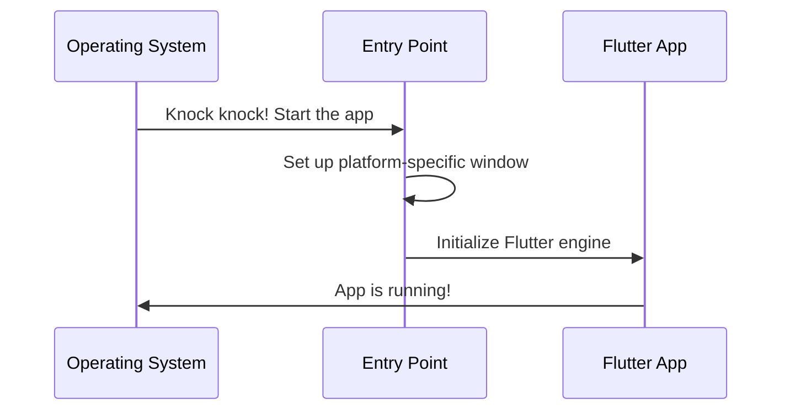
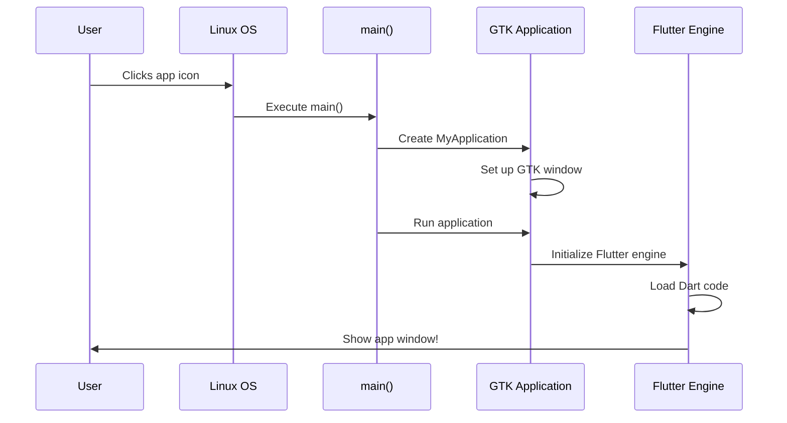

# Chapter 1: Platform Application Entry Points

Welcome to the first chapter of building our Public Safety Application! Let's start at the very beginning - understanding how your app actually starts running on different devices.

## Why Do We Need Platform Entry Points?

Imagine you're building a house that needs to work in three different countries. Each country has different building codes and standards for the front door. You can't just have one universal door - you need a special door designed for each country's requirements.

The same is true for apps! Your Public Safety Application needs to run on Linux computers, Windows PCs, and potentially mobile devices. Each of these platforms (operating systems) has its own way of starting applications. **Platform Application Entry Points** are like these special front doors - they're the specific starting points that each operating system uses to launch your app.

### Our Use Case

Let's say you want to launch the Public Safety Application on a Windows police department computer and a Linux dispatch center workstation. Both need to run the same Flutter app code, but they need different "doors" to enter through because Windows and Linux start applications differently.

## Breaking Down the Concept

Think of launching an app like this analogy:



Let's break this into three key parts:

### 1. The Entry Point Function

Every program needs a starting point - a place where the computer begins executing your code. This is typically called `main()`.

**On Linux:**
```c
int main(int argc, char** argv) {
  // Create our application
  // Run it
}
```

This is the very first function that runs when someone clicks your app icon on Linux. The `argc` and `argv` parameters contain information like command-line arguments (think of them as special instructions the user might give when starting the app).

### 2. Creating a Platform-Specific Application

Once we're inside `main()`, we need to create an application object that the platform understands.

**On Linux (using GTK):**
```c
g_autoptr(MyApplication) app = my_application_new();
```

This line creates a GTK application (GTK is a toolkit for building graphical apps on Linux). The `my_application_new()` function builds a special container that knows how to create windows and display graphics on Linux.

**On Windows:**
Windows uses a different system called Win32. Instead of creating a GTK application, we create a Win32 window:

```cpp
FlutterWindow window(project);
window.Create();
```

This creates a Windows-style window that can host your Flutter app.

### 3. Handing Over Control

After creating the platform-specific container, we hand control over to Flutter:

**On Linux:**
```c
return g_application_run(G_APPLICATION(app), argc, argv);
```

This tells the GTK application to start running and keep running until the user closes it. Inside, it initializes the Flutter engine and loads your Flutter code.

## How It Solves Our Use Case

Let's trace what happens when a dispatcher clicks your app icon on their Linux workstation:

1. **Linux double-clicks the app** → The operating system looks for the `main()` function in `linux/main.cc`
2. **main() creates a GTK application** → This sets up a Linux-compatible window
3. **The app runs** → `g_application_run()` starts everything and initializes Flutter
4. **Flutter code takes over** → Your Dart code (the actual app logic) now runs inside this Linux window

Now on a Windows police computer:

1. **Windows launches the app** → Looks for `WinMain()` (Windows' version of `main()`)
2. **Creates a Win32 window** → This sets up a Windows-compatible window using `FlutterWindow`
3. **Flutter engine starts** → The window initializes the Flutter runtime
4. **Same Flutter code runs** → Your Dart code runs inside this Windows window

**The magic**: You write your Public Safety Application once in Flutter, but these entry points automatically handle the platform-specific setup!

## Under the Hood: What Really Happens

Let's look at a step-by-step walkthrough of what happens on Linux:



### Diving Into the Linux Code

Let's examine the Linux entry point file by file:

**File: `linux/main.cc`**
```c
#include "my_application.h"

int main(int argc, char** argv) {
  g_autoptr(MyApplication) app = my_application_new();
  return g_application_run(G_APPLICATION(app), argc, argv);
}
```

- **Line 1**: Include the header that defines `MyApplication`
- **Line 3**: The entry point - this is where everything begins
- **Line 4**: Create a new application object (this is our "door")
- **Line 5**: Start running the application and wait for it to finish

**File: `linux/my_application.h`**
```c
MyApplication* my_application_new();
```

This declares a function that creates your custom GTK application. Inside this function (defined elsewhere), Flutter gets initialized and your window gets created.

### Diving Into the Windows Code

**File: `windows/runner/flutter_window.h`**
```cpp
class FlutterWindow : public Win32Window {
 public:
  explicit FlutterWindow(const flutter::DartProject& project);
  
 protected:
  bool OnCreate() override;
  void OnDestroy() override;
  
 private:
  flutter::DartProject project_;
  std::unique_ptr<flutter::FlutterViewController> flutter_controller_;
};
```

- **Line 1**: `FlutterWindow` is based on `Win32Window` (Windows' window type)
- **Line 3**: Constructor takes a `project` - this tells Flutter which app to run
- **Line 6-7**: Special functions that run when the window is created/destroyed
- **Line 11**: Stores the Flutter controller that manages your Dart code

The key difference: Linux uses GTK (a cross-platform toolkit), while Windows uses Win32 (Windows-specific). But both accomplish the same goal - creating a window for Flutter to draw in!

## Summary

In this chapter, you learned:

- **Platform Entry Points** are the specific starting functions each operating system uses to launch your app
- Each platform (Linux, Windows, iOS) needs its own entry point because they start applications differently
- The entry point creates a platform-specific window (GTK for Linux, Win32 for Windows)
- After setup, these entry points hand control to the Flutter engine, which runs your actual app code
- This architecture lets you write your app once in Flutter while supporting multiple platforms

Now that your app knows how to start on each platform, the next step is configuring platform-specific resources like app icons, names, and settings. Let's explore that in [Chapter 2: Platform Resource Configuration](02_platform_resource_configuration_.md)!

