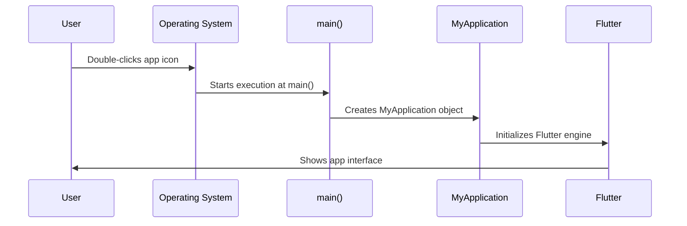
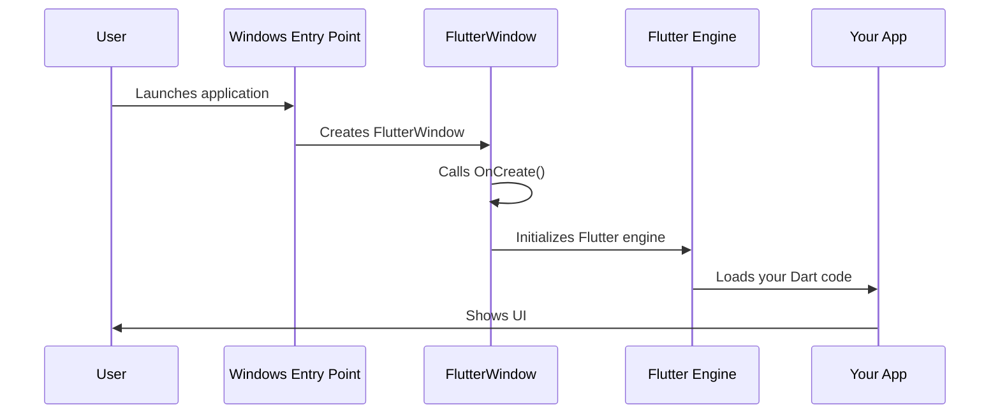

# Chapter 1: Platform-Specific Application Entry Points

Welcome to the first chapter of our Public Safety Application tutorial! In this chapter, we're going to learn about how Flutter applications start on different operating systems. Don't worry if you're new to programming—we'll take it step by step!

## What Problem Are We Solving?

Imagine you built a beautiful Flutter app to help emergency responders coordinate during incidents. You want this app to run on different computers—some using Linux, others using Windows. But here's the challenge: **Linux and Windows computers "speak different languages" when it comes to starting applications.**

Think of it like this: if you want to enter a building, you need to use the right door. A shopping mall has automatic sliding doors, while a historic building might have heavy wooden doors with traditional handles. Both let you inside, but they work differently. Similarly, your Flutter app needs a specific "entrance" for each operating system.

**Our use case:** We want to launch our Public Safety Application on both Linux and Windows computers, ensuring it starts correctly on each platform.

## Key Concepts

Let's break down what makes these platform-specific entry points work:

### 1. The Entry Point (The Main Door)

Every program needs a starting point—a place where the computer begins executing your code. This is called the **entry point**, and in most programs, it's a function called `main()`.

Here's what the Linux entry point looks like:

```c
int main(int argc, char** argv) {
  // Start the application here
}
```

**What this means:** When you double-click your app icon on Linux, the operating system finds this `main()` function and starts running your code from here. The `argc` and `argv` parts are how the operating system passes information to your app (like command-line arguments), but you don't need to worry about them right now.

### 2. Platform-Specific Toolkits

Different operating systems provide different "toolkits" to create windows, buttons, and other visual elements:

- **Linux** uses something called **GTK** (GIMP Toolkit)
- **Windows** uses **Win32** (a set of APIs built into Windows)

Think of these toolkits as different construction material sets—like LEGO vs. K'NEX. Both let you build things, but the pieces look and connect differently.

### 3. Application Objects

Before Flutter can show your beautiful interface, the operating system needs to create an **application object**—a special container that manages your app's lifecycle (starting, running, stopping).

On Linux, this looks like:

```c
g_autoptr(MyApplication) app = my_application_new();
```

**What this does:** This line creates a new application object called `app` that follows Linux's GTK rules. The `g_autoptr` part is just a smart way to automatically clean up memory when the app closes.

## How It All Works Together

Let's walk through what happens when someone launches your Public Safety Application on a Linux computer:



Here's the step-by-step breakdown:

1. **User launches the app** by double-clicking the icon
2. **The operating system** finds the `main()` function in `linux/main.cc`
3. **The main() function** creates a new application object using GTK
4. **The application object** sets up the environment and initializes Flutter
5. **Flutter** takes over and displays your beautiful user interface

## Looking at the Linux Code

Let's examine the actual entry point for Linux:

**File: `linux/main.cc`**

```c
#include "my_application.h"

int main(int argc, char** argv) {
```

This first part includes the necessary definitions and starts the main function.

```c
  g_autoptr(MyApplication) app = my_application_new();
```

Here we create our application object. The `my_application_new()` function is defined elsewhere and sets up everything GTK needs.

```c
  return g_application_run(G_APPLICATION(app), argc, argv);
}
```

Finally, we tell GTK to run our application. This function won't return until the user closes the app.

### The Application Header File

The `linux/my_application.h` file is like a blueprint that describes what our application object can do:

```c
#ifndef FLUTTER_MY_APPLICATION_H_
#define FLUTTER_MY_APPLICATION_H_
```

These lines are "include guards"—they prevent the code from being included multiple times (like putting a "Do Not Duplicate" stamp on a document).

```c
#include <gtk/gtk.h>
```

This brings in all the GTK toolkit functionality we need.

```c
MyApplication* my_application_new();
```

This declares a function that creates and returns a new application object. Think of it as a factory that produces application instances.

## Looking at the Windows Code

Windows does things differently. Instead of GTK, it uses Win32 windows:

**File: `windows/runner/flutter_window.h`**

```cpp
#include <flutter/dart_project.h>
#include <flutter/flutter_view_controller.h>
```

These lines bring in Flutter-specific functionality for Windows.

```cpp
class FlutterWindow : public Win32Window {
```

This creates a special type of window that knows how to host Flutter content. The `: public Win32Window` part means it's based on a standard Windows window but with Flutter capabilities added.

```cpp
  explicit FlutterWindow(const flutter::DartProject& project);
```

This is the constructor—the function that creates a new Flutter window. You give it a project (your Flutter app code), and it sets everything up.

```cpp
  bool OnCreate() override;
  void OnDestroy() override;
```

These are event handlers—functions that get called when the window is created or destroyed. Like having a doorbell that rings when someone arrives or leaves.

## Understanding the Flow

Let's visualize what happens on Windows when your app starts:



The process is similar to Linux, but uses Windows-specific components instead of GTK.

## Why Do We Need Different Entry Points?

You might wonder: "Why can't we just use one entry point for everything?"

Great question! Here's an analogy: Imagine you're building a house in different countries. In Japan, you might remove your shoes at the entrance. In the USA, you might keep them on. The house interior could be identical, but the entrance customs differ based on local rules.

Similarly:
- **Linux expects** a program to use GTK and follow certain conventions
- **Windows expects** a program to use Win32 and follow different conventions
- **Your Flutter app code** (the "interior" of the house) stays the same!

Flutter handles this brilliantly by providing these platform-specific "front doors" that connect to your shared Flutter code.

## What We've Learned

In this chapter, you've discovered:

- **Entry points** are where your application starts on each platform
- **Linux uses GTK** (through `main.cc` and `my_application.h`) to create applications
- **Windows uses Win32** (through `FlutterWindow`) to create windows
- These platform-specific entry points **initialize the native environment** before Flutter takes over
- Your actual app code (written in Flutter/Dart) **remains the same** across platforms!

Think of it like an international restaurant chain: the entrance and building style might differ in each country, but inside, you get the same great menu!

In the next chapter, we'll explore the [Plugin Registration System](02_plugin_registration_system_.md), where you'll learn how Flutter connects to platform-specific features like cameras, GPS, and file systems. See you there!

