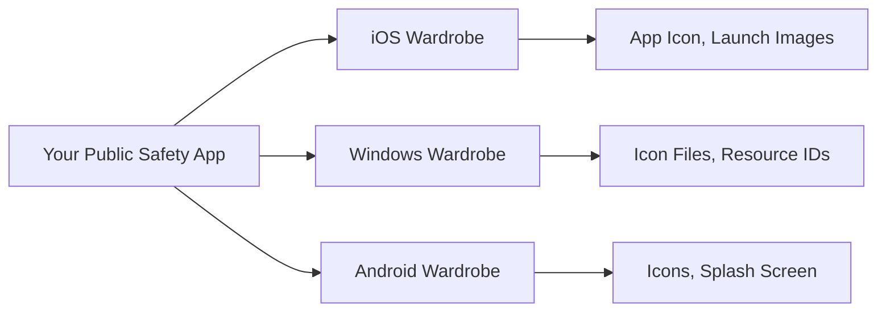
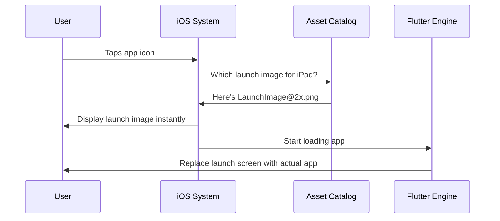
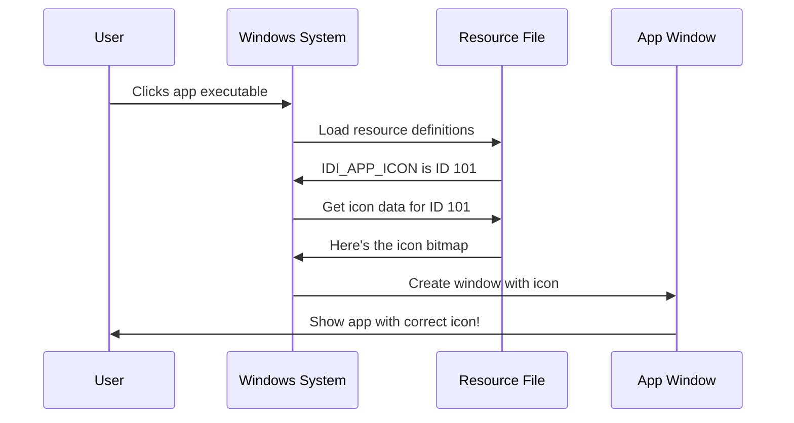
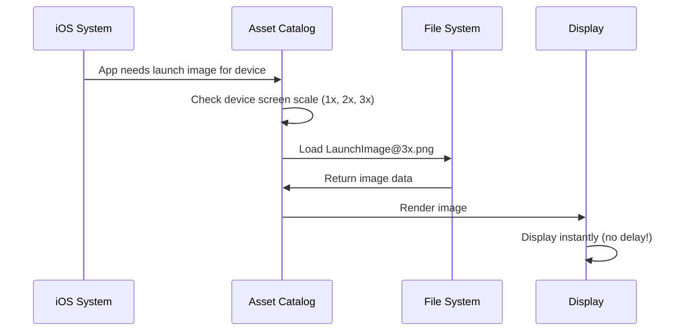
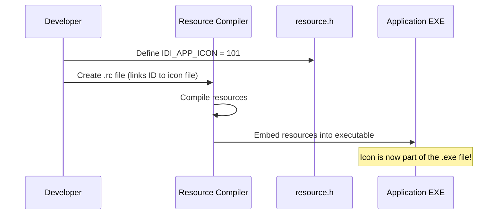

# Chapter 2: Platform Resource Configuration

Welcome back! In [Chapter 1: Platform Application Entry Points](01_platform_application_entry_points_.md), we learned how your Public Safety Application starts up on different platforms like Linux and Windows. Now that your app knows how to "open the door" on each platform, let's talk about how it presents itself!

## Why Do We Need Platform Resource Configuration?

Imagine you're attending a formal business meeting, a casual beach party, and a traditional wedding—all in the same day. You wouldn't wear the same outfit to all three events! Each occasion has its own dress code and expectations.

Your Public Safety Application faces a similar challenge. When running on iOS, users expect a certain visual style. On Windows, there are different expectations. Each platform has its own "dress code" for how apps should look and present themselves, especially during that crucial first moment when the app launches.

### Our Use Case

Let's say you're deploying your Public Safety Application to:
- **iOS tablets** for officers in the field
- **Windows desktops** for dispatch centers

When an officer taps your app icon on their iPad, they shouldn't see a blank white screen or a generic loading screen. Instead, they should immediately see a professional launch image with your app's branding and perhaps a public safety logo. The same goes for Windows—when the dispatcher clicks your app, Windows needs to know what icon to show in the taskbar and what name to display.

**Platform Resource Configuration** is how you provide these platform-specific visual assets—like app icons, launch screens, and display names—so your app looks professional and follows each platform's guidelines.

## Breaking Down the Concept

Think of Platform Resource Configuration as managing three different wardrobes:



Each platform's "wardrobe" contains:

### 1. App Icons

These are the small images users see on their home screen or taskbar. Each platform needs different sizes and formats.

### 2. Launch Screens / Splash Screens

When your app first opens, Flutter needs a moment to load. During this time, the operating system displays a launch screen. This prevents users from seeing a blank screen and provides instant visual feedback.

### 3. Resource Identifiers

These are like name tags that help the operating system find and reference your app's visual assets.

Let's explore how each platform handles these resources!

## iOS Resource Configuration

iOS is particularly picky about launch screens. Apple wants every app to feel smooth and responsive, so they require launch images that appear instantly.

### Launch Images Directory

On iOS, your launch images live in a special folder:

```
ios/Runner/Assets.xcassets/LaunchImage.imageset/
```

This folder is called an "image set" and it contains:
- Multiple versions of your launch image at different resolutions (for different screen sizes)
- A `Contents.json` file that tells iOS which image to use for which device

**Think of it like this**: You're providing small, medium, and large versions of a poster, and iOS picks the right size based on whether the user has an iPhone, iPad, or iPad Pro.

### How iOS Uses Launch Images

Here's what happens when an officer taps your app icon on their iPad:



**Step-by-step**:
1. User taps the icon
2. iOS immediately looks in the Asset Catalog
3. iOS finds the right size launch image
4. iOS displays it within milliseconds (before Flutter even starts!)
5. Flutter loads in the background
6. Once Flutter is ready, the launch image smoothly transitions to your actual app

### Customizing iOS Launch Images

Let's say you want to add your Public Safety department logo to the launch screen. Here's how:

**Step 1**: Create your launch images at different sizes:
- `LaunchImage.png` (1x - standard resolution)
- `LaunchImage@2x.png` (2x - retina displays)
- `LaunchImage@3x.png` (3x - super retina displays)

**Step 2**: Place them in:
```
ios/Runner/Assets.xcassets/LaunchImage.imageset/
```

**Step 3**: iOS automatically detects and uses them based on the device!

The README file in that folder even tells you there's an easier way:

```
You can also do it by opening your Flutter project's Xcode 
project with `open ios/Runner.xcworkspace`
```

This opens Apple's visual editor where you can drag and drop your images!

## Windows Resource Configuration

Windows handles resources differently. Instead of image sets, Windows uses a system called "resource files" that define IDs for each asset.

### Resource Header File

Let's look at the Windows resource header:

**File: `windows/runner/resource.h`**
```cpp
// Defines which icon represents the app
#define IDI_APP_ICON   101
```

**What this means**:
- `IDI_APP_ICON` is a human-readable name (like "App Icon Label")
- `101` is the numeric ID Windows uses internally
- When Windows needs to display your app icon, it looks up ID `101`

Think of it like a library catalog system: `IDI_APP_ICON` is the book title, and `101` is the shelf location number.

### The Next Value Counters

```cpp
#define _APS_NEXT_RESOURCE_VALUE   102
#define _APS_NEXT_COMMAND_VALUE    40001
#define _APS_NEXT_CONTROL_VALUE    1001
```

These are like "next available slot" markers. If you wanted to add another icon:
- You'd give it ID `102` (the next resource value)
- Then increment `_APS_NEXT_RESOURCE_VALUE` to `103`

**You typically don't modify these manually**—Visual Studio's resource editor does it for you automatically!

### How Windows Uses Resources

When your Public Safety App launches on a Windows dispatch computer:



**Step-by-step**:
1. User double-clicks your app
2. Windows loads the `resource.h` definitions
3. Windows looks up what `IDI_APP_ICON` means (ID 101)
4. Windows fetches the actual icon image stored under ID 101
5. Windows displays your app window with the correct icon in the title bar and taskbar

### Adding a Custom Windows Icon

Here's how you'd add your Public Safety logo as the Windows app icon:

**Step 1**: Create an `.ico` file (Windows icon format) containing your logo

**Step 2**: Reference it in your resource file (not shown in the snippets, but typically done in a `.rc` file):
```cpp
// In Runner.rc
IDI_APP_ICON   ICON   "resources\\app_icon.ico"
```

**Step 3**: The `resource.h` header already defines `IDI_APP_ICON` as `101`, so Windows knows where to find it!

## Utility Functions for Resource Handling

Windows also provides utility functions to help manage resources and text encoding:

**File: `windows/runner/utils.h`**
```cpp
// Gets command line arguments in a usable format
std::vector<std::string> GetCommandLineArguments();
```

This function helps your app access startup parameters (like file paths passed when double-clicking a document).

```cpp
// Converts Windows text to standard format
std::string Utf8FromUtf16(const wchar_t* utf16_string);
```

Windows uses a special text encoding called UTF-16, but Flutter uses UTF-8. This function translates between them—like a language interpreter!

**Why does this matter for resources?**
When Windows passes your app name or file paths, they're in UTF-16. These utilities convert them to UTF-8 so Flutter can understand them properly.

## Solving Our Use Case

Let's trace through what happens when deploying your Public Safety Application:

### On the iOS Tablet

1. **You add launch images** to `ios/Runner/Assets.xcassets/LaunchImage.imageset/`
   - `LaunchImage.png` - Shows your department logo
   - `LaunchImage@2x.png` - Higher resolution version
   - `LaunchImage@3x.png` - Highest resolution version

2. **Officer taps the app icon**
   - iOS instantly displays the appropriate launch image
   - The officer sees your professional logo immediately (no blank screen!)
   - Flutter loads in the background
   - After ~1-2 seconds, the app transitions to the main interface

3. **Result**: Professional first impression following iOS guidelines ✓

### On the Windows Desktop

1. **You configure the app icon** in `windows/runner/resource.h` and associated resource files
   - Set `IDI_APP_ICON` to point to your department logo
   - Windows compiles this into the executable

2. **Dispatcher clicks the app**
   - Windows reads the embedded icon resource (ID 101)
   - Windows shows your logo in the taskbar and window title
   - The app window opens with proper branding

3. **Result**: Professional appearance following Windows conventions ✓

## Under the Hood: Asset Loading

Let's understand how the iOS asset system works internally:



### Why Multiple Image Sizes?

iOS devices have different screen pixel densities:
- **1x**: Older non-retina displays (rare now)
- **2x**: Standard retina displays (most iPhones)
- **3x**: Super retina displays (iPhone Pro models)

If you only provided a 1x image and iOS stretched it for a 3x display, it would look blurry! By providing all sizes, iOS can display crisp images on any device.

### The Contents.json File

Inside the `LaunchImage.imageset` folder, there's a `Contents.json` file that looks like this:

```json
{
  "images": [
    {
      "filename": "LaunchImage.png",
      "scale": "1x"
    },
    {
      "filename": "LaunchImage@2x.png",
      "scale": "2x"
    }
  ]
}
```

**What this does**:
- Maps each filename to a scale factor
- iOS reads this JSON to know which file to use
- It's like an index in the back of a book—helps iOS find the right image quickly

## Diving Deeper: Windows Resource System

Windows uses a compiled resource system. Here's how it works:

### Resource Compilation Process



**Step-by-step**:
1. You define IDs in `resource.h` (like `IDI_APP_ICON = 101`)
2. You create a `.rc` resource script that links IDs to actual files
3. The Resource Compiler (`rc.exe`) runs during build
4. It embeds all resources directly into your `.exe` file
5. Your app now carries its icons and resources wherever it goes!

This is different from iOS, where images are separate files in a bundle. On Windows, everything is baked into the executable.

### Why Use Numeric IDs?

You might wonder: why not just use filenames like iOS?

**Historical reason**: Windows' resource system dates back to the 1980s when memory was precious. Numbers are more efficient than strings for lookups.

**Practical reason**: It allows resources to be changed without recompiling code. You can update just the resource file, and the IDs stay the same.

## Best Practices for Platform Resources

### Keep Launch Screens Simple

Launch screens should be lightweight:
- ✓ Simple logo or brand colors
- ✓ Minimal text (like "Public Safety App")
- ✗ Complex animations (they won't run yet!)
- ✗ Loading indicators (iOS guidelines discourage these)

**Why?** The launch screen appears before your code runs. It's just a static image, so keep it simple and professional.

### Provide All Required Sizes

Each platform expects different image sizes:
- **iOS**: 1x, 2x, 3x versions
- **Windows**: Typically 16x16, 32x32, 48x48, 256x256 pixels in one `.ico` file
- **Android**: mdpi, hdpi, xhdpi, xxhdpi, xxxhdpi

**Pro tip**: Create your original artwork at the highest resolution, then scale down. Scaling up causes blurriness!

### Follow Platform Guidelines

- **iOS**: Read Apple's [Human Interface Guidelines](https://developer.apple.com/design/human-interface-guidelines/)
- **Windows**: Follow Microsoft's [Windows App Design](https://docs.microsoft.com/windows/apps/design/) guidance

These guidelines ensure your app feels native to each platform.

## Summary

In this chapter, you learned:

- **Platform Resource Configuration** provides the visual assets each operating system needs to display your app professionally
- **iOS uses Asset Catalogs** with multiple image sizes for different device resolutions, stored in `.xcassets` folders
- **Windows uses Resource Files** with numeric IDs defined in `resource.h`, compiled directly into the executable
- **Launch screens appear instantly** before Flutter loads, providing immediate feedback to users
- Each platform has its own conventions, and following them makes your app feel native and professional

Now that your Public Safety Application knows how to start ([Chapter 1: Platform Application Entry Points](01_platform_application_entry_points_.md)) and look professional with proper icons and launch screens (this chapter), the next step is connecting to platform-specific functionality. What if your app needs to access the device's camera for incident photos, or use GPS for location tracking? That's where plugins come in!

Continue to [Chapter 3: Platform Plugin Registration](03_platform_plugin_registration_.md) to learn how your Flutter app communicates with native platform features!

