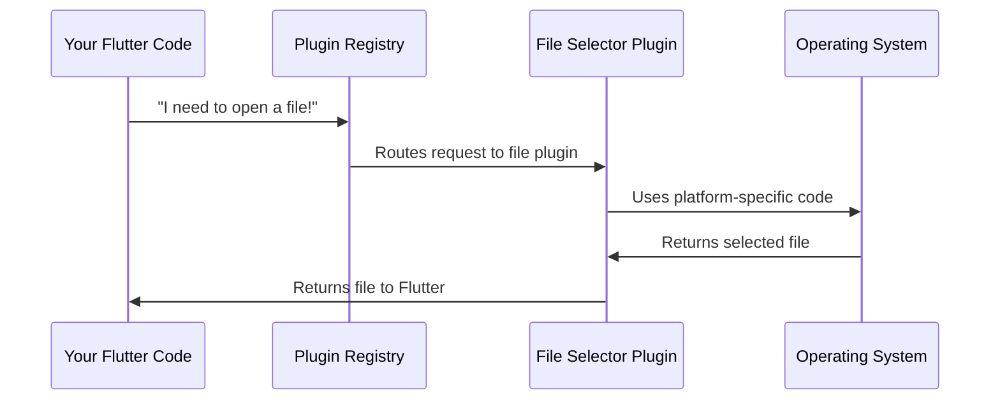
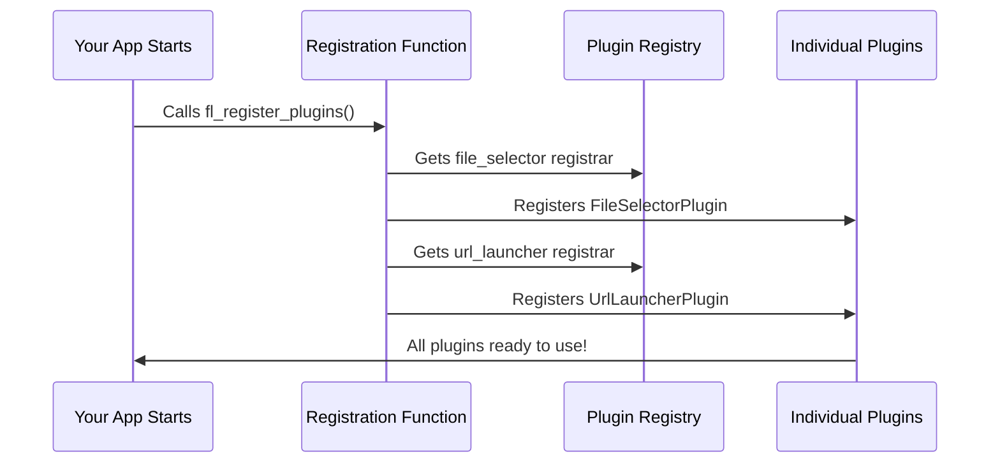
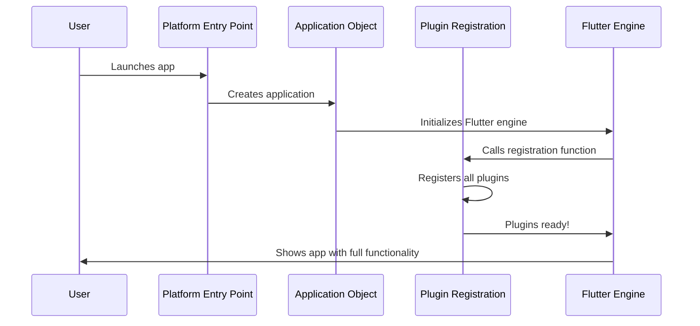

# Chapter 2: Plugin Registration System

Welcome back! In [Chapter 1: Platform-Specific Application Entry Points](01_platform_specific_application_entry_points_.md), we learned how Flutter applications start differently on Linux and Windows, like having different entrance doors for the same building. Now let's explore something equally important: how your Flutter app actually uses platform-specific features!

## What Problem Are We Solving?

Imagine you're building our Public Safety Application, and you need to add a feature where emergency responders can **open files** (like incident reports) or **launch web URLs** (to access live maps). Here's the challenge:

- On **Linux**, opening a file uses GTK's file dialog
- On **Windows**, opening a file uses Win32's file dialog
- Your **Flutter code** is written in Dart, which doesn't directly understand either!

It's like you speak English, but you need to communicate with people who speak completely different languages. You need a **translator** for each language!

**Our use case:** We want to write simple Dart code like `openFile()` once, and have it automatically work correctly on both Linux and Windows.

This is where the **Plugin Registration System** comes in—it's like a universal translation service that connects your Flutter code to native platform features!

## Understanding the Big Picture

Before diving into details, let's visualize how this system works:



Think of the **Plugin Registry** as a telephone switchboard operator from the old days. When you want to make a call (use a native feature), the operator connects you to the right person (the right plugin for your platform).

## Key Concepts

Let's break down the Plugin Registration System into bite-sized pieces:

### 1. What is a Plugin?

A **plugin** is a bridge between your Flutter (Dart) code and native platform features. 

**Analogy:** Remember our power adapter example? When you travel to Europe with a US laptop, you need an adapter. The laptop (your Flutter code) stays the same, but the adapter translates the power plug to match European sockets (the native platform).

Our Public Safety Application uses two plugins:

- **file_selector_linux**: Opens file dialogs on Linux
- **url_launcher_linux**: Opens web URLs on Linux

(There are equivalent Windows versions too!)

### 2. What is a Plugin Registry?

The **Plugin Registry** is like a phone book or directory that keeps track of all available plugins. When your Flutter code needs a native feature, it looks up the right plugin in this registry.

Think of it like a restaurant menu—you don't need to know how the chef makes each dish, you just order from the menu, and the kitchen handles the details!

### 3. What is Plugin Registration?

**Plugin Registration** is the process of adding plugins to the registry when your app starts. It's like checking in guests at a hotel—you need to register who's staying before they can use the facilities.

Here's what happens:



## How the Registration System Works

Let's look at the actual registration code for Linux. Don't worry—we'll go through it step by step!

**File: `linux/flutter/generated_plugin_registrant.cc`**

### Step 1: Including Plugin Headers

```cpp
#include "generated_plugin_registrant.h"
#include <file_selector_linux/file_selector_plugin.h>
#include <url_launcher_linux/url_launcher_plugin.h>
```

**What this does:** These lines bring in the necessary code definitions, like gathering ingredients before cooking. Each `#include` imports the "recipe" for one plugin.

- The first line includes our own header file (we'll see that soon)
- The second imports the file selector plugin
- The third imports the URL launcher plugin

### Step 2: The Main Registration Function

```cpp
void fl_register_plugins(FlPluginRegistry* registry) {
```

**What this means:** This declares a function called `fl_register_plugins` that takes a plugin registry as input. Think of `registry` as an empty address book that we're about to fill with plugin contacts.

The `void` means this function doesn't return any value—it just does its job and finishes.

### Step 3: Registering the File Selector

```cpp
  g_autoptr(FlPluginRegistrar) file_selector_linux_registrar =
      fl_plugin_registry_get_registrar_for_plugin(registry, "FileSelectorPlugin");
  file_selector_plugin_register_with_registrar(file_selector_linux_registrar);
```

Let's break this down:

**Line 1:** Creates a special object called a "registrar" for the file selector plugin. Think of it as getting a registration form specifically for this plugin.

- `fl_plugin_registry_get_registrar_for_plugin(registry, "FileSelectorPlugin")` asks the registry: "Give me a registration form for the FileSelectorPlugin"
- `g_autoptr` automatically cleans up when we're done (like returning a library book automatically)

**Line 2:** Actually registers the plugin using that form. It's like submitting the completed registration!

- `file_selector_plugin_register_with_registrar()` says: "Here's my plugin, please add it to the system!"

### Step 4: Registering the URL Launcher

```cpp
  g_autoptr(FlPluginRegistrar) url_launcher_linux_registrar =
      fl_plugin_registry_get_registrar_for_plugin(registry, "UrlLauncherPlugin");
  url_launcher_plugin_register_with_registrar(url_launcher_linux_registrar);
}
```

**What this does:** The exact same process as the file selector, but for the URL launcher plugin. 

Notice the pattern? Each plugin follows the same two-step process:
1. Get a registrar (registration form)
2. Register the plugin using that registrar (submit the form)

## The Header File

Now let's look at the header file that declares our registration function:

**File: `linux/flutter/generated_plugin_registrant.h`**

```cpp
#ifndef GENERATED_PLUGIN_REGISTRANT_
#define GENERATED_PLUGIN_REGISTRANT_
```

**What this does:** These are "include guards"—they prevent this file from being included multiple times, like putting a "Already Processed" stamp on a document so it doesn't get processed twice.

```cpp
#include <flutter_linux/flutter_linux.h>
```

**What this does:** Brings in Flutter's core Linux functionality. Without this, we wouldn't know what a `FlPluginRegistry` is!

```cpp
void fl_register_plugins(FlPluginRegistry* registry);
```

**What this does:** This is a **declaration** (not the full implementation—we saw that earlier). It's like a table of contents that says "this function exists." The actual code is in the `.cc` file.

```cpp
#endif  // GENERATED_PLUGIN_REGISTRANT_
```

**What this does:** Closes the include guard we opened at the top.

## How Windows Does It

The Windows version works almost identically! Let's look at its header file:

**File: `windows/flutter/generated_plugin_registrant.h`**

```cpp
#include <flutter/plugin_registry.h>
```

This brings in Windows-specific Flutter functionality (notice it's `flutter/plugin_registry.h` instead of `flutter_linux/flutter_linux.h`).

```cpp
void RegisterPlugins(flutter::PluginRegistry* registry);
```

The registration function is called `RegisterPlugins` instead of `fl_register_plugins`, and uses Windows naming conventions (`flutter::PluginRegistry`), but it does **exactly the same job**!

## When Does Registration Happen?

You might wonder: "When does this registration actually occur?" Great question! Let's trace the journey:



Here's what happens:

1. **User launches the app** (remember from [Chapter 1: Platform-Specific Application Entry Points](01_platform_specific_application_entry_points_.md)?)
2. **Platform-specific entry point runs** (`main()` on Linux, `WinMain()` on Windows)
3. **Application object is created** (like `MyApplication` on Linux)
4. **Flutter engine initializes** and prepares to run your Dart code
5. **Flutter automatically calls the registration function** (`fl_register_plugins()` or `RegisterPlugins()`)
6. **All plugins register themselves** with the registry
7. **Your Flutter code runs** with full access to native features!

## Using Plugins in Your Flutter Code

Now comes the exciting part—actually using these plugins! In your Flutter (Dart) code, you can simply do:

```dart
import 'package:url_launcher/url_launcher.dart';

// Later in your code...
await launch('https://emergency-map.example.com');
```

**What happens behind the scenes:**

1. Your Dart code calls `launch()`
2. Flutter looks up "url_launcher" in the plugin registry
3. The registry routes the call to `UrlLauncherPlugin`
4. The plugin uses Linux or Windows native code to open the URL
5. The browser opens—magic! ✨

You never had to write platform-specific code! The plugin system handled everything.

## Why is This File "Generated"?

You might have noticed the comment at the top of these files:

```cpp
// Generated file. Do not edit.
```

This means Flutter **automatically creates this file** for you! Here's how:

1. You add plugins to your `pubspec.yaml` file (Flutter's configuration file)
2. You run `flutter pub get`
3. Flutter scans your plugins and **automatically generates** the registration code
4. The generated file includes all necessary plugins

**Analogy:** It's like ordering a pizza online—you select toppings (plugins), and the system automatically generates the order list (registration code). You don't manually write the order!

This is brilliant because:
- **You never forget to register a plugin**—it happens automatically
- **Adding new plugins is easy**—just add them to `pubspec.yaml` and Flutter does the rest
- **Different platforms get the right code**—Linux gets Linux plugins, Windows gets Windows plugins

## The Power of Abstraction

Let's appreciate what we've learned. Without the plugin registration system, you'd have to write code like this:

```dart
// Without plugins (hypothetical nightmare scenario)
if (Platform.isLinux) {
  // Write Linux-specific GTK code...
  // Hundreds of lines of C code...
} else if (Platform.isWindows) {
  // Write Windows-specific Win32 code...
  // More hundreds of lines of C++ code...
}
```

But WITH the plugin system, you simply write:

```dart
await launch('https://emergency-map.example.com');
```

One line. Works everywhere. That's the magic of the Plugin Registration System!

## Real-World Example: Public Safety Application

Let's put this together for our Public Safety Application. Imagine you want to add a button that opens incident reports:

**Your Flutter code:**

```dart
import 'package:file_selector/file_selector.dart';

Future<void> openIncidentReport() async {
  final file = await openFile();
  if (file != null) {
    // Read and display the incident report
  }
}
```

**What happens:**

1. You call `openFile()` from the `file_selector` package
2. The plugin registry routes this to `FileSelectorPlugin`
3. On Linux, it shows a GTK file dialog
4. On Windows, it shows a Win32 file dialog
5. You get back the selected file—same result on both platforms!

You wrote **one version** of the code, but it works perfectly on **multiple platforms**. That's the plugin registration system doing its job!

## What We've Learned

In this chapter, you've discovered:

- **Plugins** are bridges between Flutter (Dart) code and native platform features
- The **Plugin Registry** keeps track of all available plugins, like a phone book
- **Plugin Registration** happens automatically when your app starts
- Flutter **automatically generates** the registration code based on your `pubspec.yaml`
- You can write **platform-independent Flutter code** that works everywhere!
- The system works identically on Linux (using `fl_register_plugins()`) and Windows (using `RegisterPlugins()`)

Think of it like international shipping: You write one address on a package (your Flutter code), and the postal system (plugin registry) automatically figures out the route, customs forms, and delivery method for each country (platform). The package arrives everywhere, even though the delivery details differ!

In the next chapter, we'll explore [Platform Bridge Headers](03_platform_bridge_headers_.md), where you'll learn how the communication between Flutter and native code actually happens at a lower level. This will complete your understanding of how Flutter connects to the native world. See you there!

