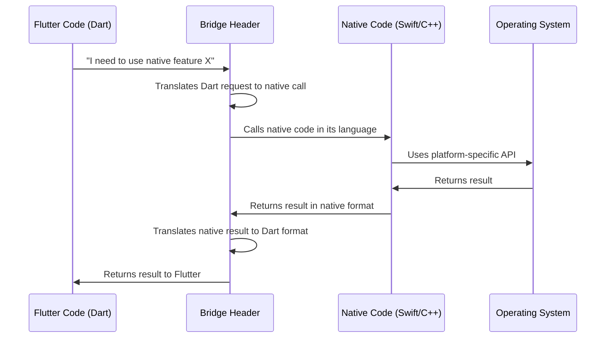
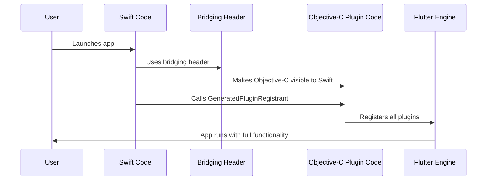
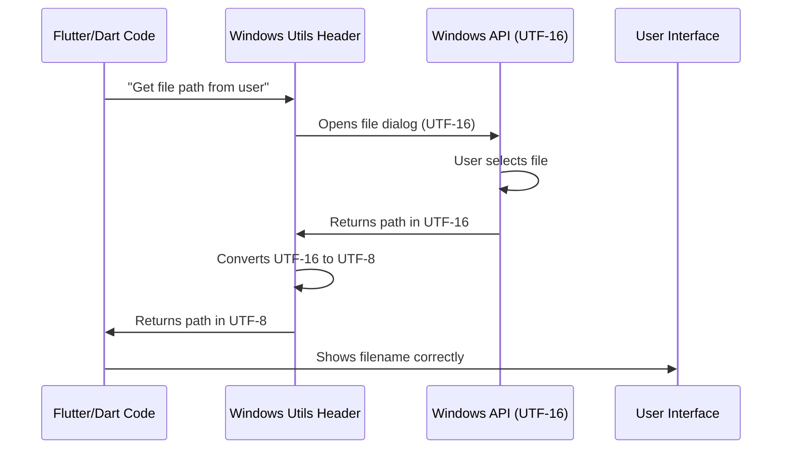

# Chapter 3: Platform Bridge Headers

Welcome back! In [Chapter 2: Plugin Registration System](02_plugin_registration_system_.md), we learned how Flutter registers plugins—like signing guests into a hotel—so your Flutter code can use native platform features. But there's a deeper layer we need to understand: **how do different programming languages actually "talk" to each other?**

Imagine you're at an international conference where people speak English, Japanese, and German. Everyone needs to communicate, but they speak different languages! You'd need interpreters to translate between languages. That's exactly what **Platform Bridge Headers** do—they're translators that allow different programming languages to work together.

## What Problem Are We Solving?

Let's make this concrete with our Public Safety Application. Here's the challenge:

- Your **Flutter UI code** is written in **Dart**
- On **iOS**, native features (like the camera or GPS) are written in **Swift** or **Objective-C**
- On **Windows**, native utilities (like file operations) are written in **C++**
- Flutter's core engine itself includes **C++ code**

How do all these different languages work together in one application? They literally can't understand each other directly!

**Our use case:** We need to enable our iOS Public Safety Application (written mostly in Flutter/Dart) to communicate with Swift/Objective-C code, and our Windows version to work with C++ utilities. Without bridge headers, these languages would be completely isolated—like people speaking different languages without interpreters!

## Understanding the Big Picture

Before diving into code, let's visualize what platform bridge headers do:



Think of the bridge header as a **multilingual interpreter** standing between Flutter and native code, translating back and forth!

## Key Concepts

Let's break down the concept of bridge headers into digestible pieces:

### 1. What is a Header File?

A **header file** is like a table of contents or an index in a book. It declares what functions and features are available, without showing the full implementation.

**Analogy:** Imagine a restaurant menu. The menu (header file) tells you what dishes are available and what ingredients they contain, but it doesn't explain exactly how the chef cooks them. The kitchen (implementation files) handles the actual cooking.

In programming:
- **Header files** end with `.h` (like `Runner-Bridging-Header.h` or `utils.h`)
- They **declare** what exists: "Here's a function called `openFile`"
- The actual **implementation** lives in other files (like `.cpp` or `.m` files)

### 2. What is a Bridge?

A **bridge** in programming connects two separate systems that otherwise couldn't communicate. 

**Analogy:** Think of a physical bridge connecting two islands. People on one island speak English, people on the other speak Spanish. The bridge allows them to travel between islands, but they still need interpreters (the translation logic) to actually communicate.

In our case:
- **One island** is Flutter's Dart world
- **The other island** is the native platform world (Swift/Objective-C on iOS, C++ on Windows)
- The **bridge header** connects them and provides translation rules

### 3. What is a Bridging Header Specifically?

On **iOS**, Apple provides a special type of header file called a **Bridging Header** that specifically connects Objective-C/C++ code to Swift code.

Since Flutter uses both Swift (for iOS app structure) and C++ (for Flutter engine), we need this bridge to make them work together!

## The iOS Bridging Header

Let's look at the simplest bridge header in our project—the iOS bridging header:

**File: `ios/Runner/Runner-Bridging-Header.h`**

```objc
#import "GeneratedPluginRegistrant.h"
```

That's it! Just one line. But don't let its simplicity fool you—this single line is incredibly powerful.

### Breaking Down the iOS Bridge

Let's understand what this line does:

**`#import`** — This keyword says: "Bring in all the declarations from another file." It's like saying "Copy the table of contents from this other book into mine."

**`"GeneratedPluginRegistrant.h"`** — This is the file we're importing. Remember from [Chapter 2: Plugin Registration System](02_plugin_registration_system_.md)? This file contains the declarations for registering all your Flutter plugins!

**What this enables:**
- **Swift code** can now see and call plugin registration functions
- **Objective-C code** (which is what Flutter plugins often use on iOS) becomes visible to Swift
- The **bridge** is established between Swift and Objective-C worlds

### Why Do We Need This on iOS?

Here's the thing about iOS development: Apple uses multiple languages:
- **Swift** — Modern, safer language (preferred for new code)
- **Objective-C** — Older language (many existing iOS libraries use it)
- **C++** — Flutter's engine is written in C++

By default, Swift and Objective-C can't see each other's code. The bridging header **exposes Objective-C code to Swift**, allowing them to work together.

**Analogy:** Imagine two departments in a company: Marketing (Swift) and Engineering (Objective-C). They both have important information, but they use different terminology and communication styles. The bridging header is like a shared document that translates terms so both departments can understand each other's work.

### What Happens When the App Starts

Let's trace what happens on iOS when your Public Safety Application starts:



Here's the step-by-step:

1. **User launches** the iOS app
2. **Swift code starts running** (remember the entry point from [Chapter 1](01_platform_specific_application_entry_points_.md)?)
3. **Swift encounters the bridging header** which makes Objective-C code visible
4. **Swift can now call** `GeneratedPluginRegistrant` (which is written in Objective-C)
5. **Plugins get registered** (as we learned in [Chapter 2](02_plugin_registration_system_.md))
6. **Flutter engine starts** with all plugins available!

Without this bridging header, the Swift code would have no idea that `GeneratedPluginRegistrant` even exists—it would be invisible!

## The Windows Utility Headers

Now let's switch to Windows. Unlike iOS (which needs Swift-Objective-C bridging), Windows uses C++ throughout. But it still needs helper headers to provide useful **utility functions** that make life easier.

### The Resource Header

Let's look at one Windows header:

**File: `windows/runner/resource.h`**

```cpp
#define IDI_APP_ICON                    101
```

This line is incredibly simple but important. Let's break it down:

**`#define`** — This creates a constant (a value that never changes). It's like giving a nickname to a number.

**`IDI_APP_ICON`** — This is a human-readable name. Much easier to remember than "101"!

**`101`** — This is the actual numeric identifier that Windows uses internally to find your app's icon.

**What this does:** When your app needs to display its icon, the code can say `IDI_APP_ICON` instead of remembering the magic number `101`. 

**Analogy:** Instead of remembering your friend's phone number (like 555-0123), you save it under their name in your contacts ("Sarah"). Later, you just tap "Sarah" instead of typing the number. `IDI_APP_ICON` is like "Sarah"—a friendly name for something technical.

### Why Use Resource Headers?

Windows applications need resources like:
- **Icons** (the app icon you see in the taskbar)
- **Menus** (right-click menus, etc.)
- **Dialogs** (popup windows)

Each resource needs a unique ID number. Instead of scattering magic numbers like `101`, `102`, `103` throughout your code, you define them once in a resource header with meaningful names.

**Without resource header:**
```cpp
ShowIcon(101);  // What is 101? Who knows!
```

**With resource header:**
```cpp
ShowIcon(IDI_APP_ICON);  // Ah, the app icon! Clear!
```

The second version is much more readable and maintainable!

## The Utils Header (Translation Layer)

Now let's look at the most interesting Windows header—the utilities header:

**File: `windows/runner/utils.h`**

This header declares several important utility functions. Let's explore them one by one:

### Function 1: Creating a Console

```cpp
void CreateAndAttachConsole();
```

**What this declares:** A function that creates a debugging console window (like a terminal) for your app.

**Why you need it:** Normally, Windows GUI apps don't have a console, making debugging difficult. This function creates one so you can see `print` statements and error messages.

**What happens when you call it:**
- Windows creates a new console window
- Your app's output (like `print("Hello")` in Dart) appears in that window
- Much easier to debug issues!

**Analogy:** It's like turning on the lights in a dark room. Your app is still running, but now you can see what's happening!

### Function 2: Text Encoding Conversion

```cpp
std::string Utf8FromUtf16(const wchar_t* utf16_string);
```

This is where the "translation" aspect really shines! Let's break down what this does:

**`std::string`** — The return type. This function gives you back a string (text).

**`Utf8FromUtf16`** — The function name clearly tells you: it converts from UTF-16 encoding to UTF-8 encoding.

**`const wchar_t* utf16_string`** — The input: a UTF-16 encoded string.

**What's UTF-16 and UTF-8?** These are different ways to represent text in computer memory:
- **UTF-16**: Used internally by Windows (2 or 4 bytes per character)
- **UTF-8**: Used by Flutter/Dart and most of the internet (1-4 bytes per character)

**Why do we need conversion?**

Windows speaks UTF-16. Flutter speaks UTF-8. They're like using different alphabets! This function **translates** between them.

**Analogy:** Imagine Windows writes addresses in kanji (Japanese characters), but Flutter writes addresses in the Latin alphabet. Before Flutter can understand a Windows address, you need to transliterate it from kanji to Latin letters. That's what `Utf8FromUtf16` does for text!

**Real-world example in our Public Safety App:**

When a user picks a file on Windows, Windows gives you the filename in UTF-16:
```cpp
// Windows gives you this (UTF-16)
"C:\Reports\事故報告.txt"
```

Flutter needs it in UTF-8:
```cpp
// After conversion (UTF-8)
"C:\Reports\事故報告.txt"  // Same text, different encoding
```

Without this conversion function, filenames with non-English characters might appear as gibberish or cause crashes!

### Function 3: Getting Command Line Arguments

```cpp
std::vector<std::string> GetCommandLineArguments();
```

**What this declares:** A function that retrieves command-line arguments passed to your app.

**`std::vector<std::string>`** — Returns a list of strings (the arguments).

**What are command-line arguments?** When you launch an app from the terminal, you can pass extra information:

```
PublicSafetyApp.exe --debug --report=incident123.txt
```

Here, `--debug` and `--report=incident123.txt` are arguments. This function retrieves them so your Flutter code can use them!

**Why do we need this?** Windows gives command-line arguments in UTF-16 (remember, Windows loves UTF-16!), but Flutter needs them in UTF-8. This function:
1. Gets the arguments from Windows (UTF-16)
2. Converts them to UTF-8
3. Returns them in a format Flutter can use

**Analogy:** It's like a hotel concierge who receives messages in one language, translates them, and delivers them to guests in their preferred language.

## How Bridge Headers Work Together

Let's see how these bridge headers enable communication across your entire application:



Notice how the utils header sits in the middle, translating between Windows (UTF-16) and Flutter (UTF-8)? That's the power of platform bridge headers!

## Real-World Example: Displaying a File Path

Let's put this all together with a concrete example from our Public Safety Application:

**Scenario:** A user selects an incident report file, and we want to display the filename.

**Step 1:** User picks a file through Windows dialog
```cpp
// Windows returns (UTF-16 encoding)
wchar_t* path = L"C:\Reports\緊急.txt";  // Japanese characters!
```

**Step 2:** We convert to UTF-8 using our utility function
```cpp
std::string utf8_path = Utf8FromUtf16(path);
// Now it's: "C:\Reports\緊急.txt" in UTF-8
```

**Step 3:** Flutter receives and displays it
```dart
// Your Flutter code
String filePath = getNativePath();  // Gets the UTF-8 version
Text(filePath);  // Displays correctly: "C:\Reports\緊急.txt"
```

**Without the bridge header utility:** The Japanese characters might appear as `���` or cause a crash!

**With the bridge header utility:** Everything works perfectly, regardless of language! 🎉

## Why These Headers Are Essential

Let's summarize why platform bridge headers are crucial:

### For iOS (Bridging Header)
- **Connects Swift and Objective-C** — Two different languages that otherwise can't see each other
- **Enables plugin registration** — Swift can call Objective-C plugin code
- **Minimal but powerful** — Just one line, but essential for the entire system to work!

### For Windows (Utility Headers)
- **Provides text encoding conversion** — Bridges the gap between Windows (UTF-16) and Flutter (UTF-8)
- **Makes resources accessible** — Defines human-readable names for icons and other resources
- **Supplies helper functions** — Common operations like getting command-line arguments

**Analogy time:** Think of building an international space station where American astronauts (Flutter/Dart), Russian cosmonauts (iOS native code), and Japanese astronauts (Windows native code) all need to work together. 

Bridge headers are like:
- **Common communication protocols** everyone understands
- **Translation dictionaries** for technical terms
- **Shared interface standards** (like standardizing power outlets and air connectors)

Without them, everyone would be speaking different languages and using incompatible equipment!

## The Generated Nature

You might have noticed that the iOS bridging header is **not marked as generated**, while many plugin files are. Here's why:

**iOS Bridging Header (`Runner-Bridging-Header.h`):**
- Created **once** when you create an iOS Flutter project
- You **can** manually add more imports if you add custom Objective-C code
- Usually doesn't need changes unless you're doing advanced customization

**Windows Utility Header (`utils.h`):**
- Part of the **Flutter template** for Windows
- Provides commonly needed utilities
- You **can** add more utility functions if needed

**Generated Plugin Registrant (from [Chapter 2](02_plugin_registration_system_.md)):**
- **Automatically regenerated** whenever you add/remove plugins
- Should **never be manually edited** (your changes would be overwritten!)

Think of it like this:
- **Bridge headers**: The foundation of a building—laid once, rarely changes
- **Generated files**: The furniture—automatically rearranged whenever your needs change

## Common Patterns Across Platforms

Even though iOS and Windows use different bridge headers, they share common goals:

| Goal | iOS Solution | Windows Solution |
|------|--------------|------------------|
| **Language bridging** | Swift ↔ Objective-C bridging header | C++ (no bridging needed—same language!) |
| **Text encoding** | Usually UTF-8 throughout | UTF-16 ↔ UTF-8 conversion utilities |
| **Resource management** | Built into iOS framework | Resource header with defined constants |
| **Debugging support** | Xcode console built-in | `CreateAndAttachConsole()` utility |

**The beautiful part:** As a Flutter developer, you usually don't need to think about these differences! The bridge headers handle them automatically, and you just write Flutter code that works everywhere.

## What We've Learned

In this chapter, you've discovered:

- **Platform bridge headers** are translation layers that allow different programming languages to work together
- On **iOS**, the bridging header connects Swift and Objective-C code, making plugin registration possible
- On **Windows**, utility headers provide encoding conversion (UTF-16 ↔ UTF-8) and helper functions
- **Text encoding** matters! Windows uses UTF-16, Flutter uses UTF-8, and bridge utilities translate between them
- These headers enable your **single Flutter codebase** to seamlessly communicate with multiple native platforms
- Bridge headers are like **interpreters at an international conference**—they enable everyone to understand each other!

Think of your Flutter app as a multilingual team working on an emergency response system. The team has members who speak English (Dart), Russian (Swift/Objective-C), and Mandarin (C++). Platform bridge headers are the skilled interpreters who ensure everyone understands each other, allowing the team to work together seamlessly despite language differences!

## Your Journey So Far

You've now completed the foundational trilogy of understanding how Flutter connects to native platforms:

1. **[Chapter 1: Platform-Specific Application Entry Points](01_platform_specific_application_entry_points_.md)** — You learned how apps start differently on each platform (the "front door")

2. **[Chapter 2: Plugin Registration System](02_plugin_registration_system_.md)** — You discovered how Flutter registers plugins to use native features (the "guest registry")

3. **Chapter 3: Platform Bridge Headers** (this chapter) — You now understand how different programming languages communicate (the "interpreters")

Together, these three concepts form the complete picture of how your single Flutter codebase can run on multiple platforms while accessing native features! You're now equipped to understand how Flutter builds truly cross-platform applications.

Congratulations on completing this chapter! You now have a solid foundation in how Flutter bridges the gap between Dart and native code. This knowledge will help you debug issues, understand plugin documentation, and appreciate the engineering that makes Flutter's "write once, run anywhere" philosophy possible! 🚀

