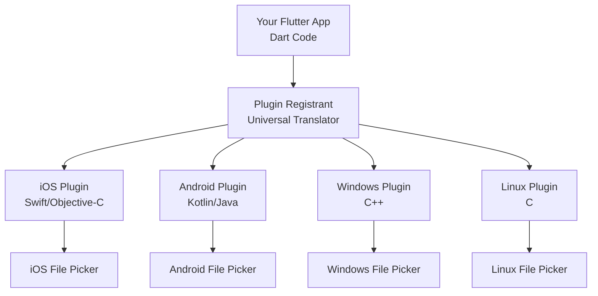
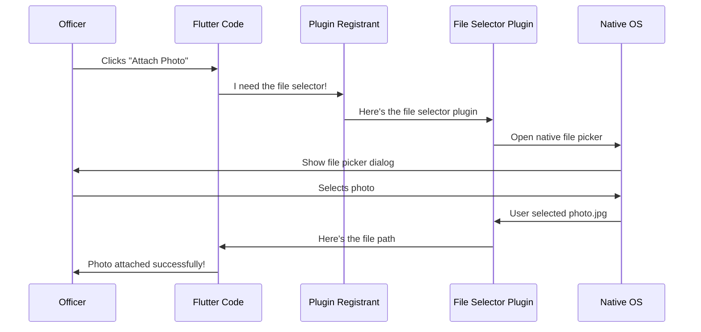
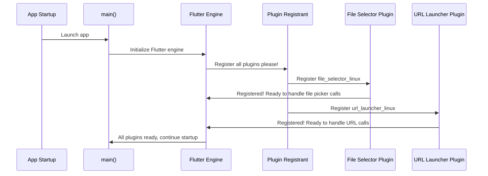

# Chapter 3: Platform Plugin Registration

Welcome back! In [Chapter 2: Platform Resource Configuration](02_platform_resource_configuration_.md), we learned how to make your Public Safety Application look professional with proper icons and launch screens on different platforms. Now your app can start up and present itself beautifully, but what if it needs to actually *do* something platform-specific?

## Why Do We Need Platform Plugin Registration?

Imagine you're building a universal remote control that works with TVs, air conditioners, and sound systems from different manufacturers. Each device speaks a different "language"—Sony TVs use one protocol, Samsung uses another, and LG uses yet another. Your universal remote needs a translation system that can speak to each device in its own language.

Your Public Safety Application faces a similar challenge! Written in Flutter (which uses the Dart programming language), your app needs to access device-specific features like:
- **Opening a file picker** to attach incident photos
- **Launching a web browser** to view external reports
- **Accessing GPS** for location tracking
- **Using the camera** for taking evidence photos

But here's the problem: Flutter doesn't directly know how to talk to iOS cameras, Android GPS, or Windows file systems. Each platform has its own native way of accessing these features, written in different languages (Swift for iOS, Kotlin for Android, C++ for Windows).

**Platform Plugin Registration** is the universal translator that connects your Flutter code to these native platform features. Think of it as a phone book that tells Flutter, "When you need to open a file picker on Linux, call this specific Linux code. When you need the same thing on Windows, call this Windows code instead."

### Our Use Case

Let's say your Public Safety Application needs two features:
1. **Attach photos to incident reports** - Officers should be able to click "Attach Photo" and browse their device to select an image file
2. **Open external links** - When viewing a report, users should be able to click links that open in their default web browser

For feature #1, you need a **file picker**. For feature #2, you need a **URL launcher**. But iOS, Windows, and Linux all handle file picking and URL launching differently! 

Platform Plugin Registration automatically sets up the connections so when your Flutter code says "open file picker," the right platform-specific code gets called, whether you're on iOS, Linux, or Windows.

## Breaking Down the Concept

Think of Platform Plugin Registration as a multilingual switchboard operator:



Let's break this into key concepts:

### 1. Plugins

A **plugin** is a piece of code that bridges Flutter with native platform features. Each plugin typically handles one specific capability (like file picking, URL launching, or camera access).

**Example**: The `file_selector` plugin knows how to open file pickers on iOS, Android, Windows, Linux, and web—all from one Flutter API!

### 2. The Plugin Registrant

The **plugin registrant** is an automatically generated file that lists all the plugins your app uses and registers them with Flutter when the app starts.

Think of it as the guest list at a party. When Flutter starts up, it checks this list and says, "Okay, I need to make sure all these plugins are ready to go!"

### 3. Platform-Specific Registration

Each platform has its own registrant file because they register plugins differently:
- **iOS**: Uses Objective-C bridging
- **Linux**: Uses C function calls
- **Windows**: Uses C++ classes

But don't worry—these files are **automatically generated**! You don't write them by hand.

## How Plugins Work in Your App

Let's trace what happens when an officer clicks "Attach Photo" in your Public Safety Application:



**Step-by-step**:
1. Officer clicks "Attach Photo" button
2. Your Flutter code calls the file_selector plugin API
3. The plugin registrant connects your request to the platform-specific file_selector code
4. The native platform code opens the OS's file picker dialog
5. Officer selects a photo
6. The native code returns the file path back through the plugin
7. Your Flutter code receives the file path and can now upload it!

The magic is that steps 3-6 happen completely differently on iOS vs. Linux vs. Windows, but your Flutter code (step 2) stays exactly the same!

## Understanding the Generated Files

Let's look at the actual registration files in your Public Safety Application. Remember, these are **automatically generated**—Flutter creates them for you based on which plugins you've added to your `pubspec.yaml` file.

### Linux Plugin Registration

**File: `linux/flutter/generated_plugin_registrant.h`**
```cpp
// Registers Flutter plugins.
void fl_register_plugins(FlPluginRegistry* registry);
```

This header file declares a function called `fl_register_plugins`. Think of it as saying, "Hey, there's a function that will register all our plugins—here's its name and what it expects."

**What it does**:
- Declares a registration function for Linux
- Takes a `FlPluginRegistry*` (a pointer to Flutter's plugin registry on Linux)
- The actual implementation is in the `.cc` file

**File: `linux/flutter/generated_plugin_registrant.cc`**
```cpp
#include "generated_plugin_registrant.h"

#include <file_selector_linux/file_selector_plugin.h>
#include <url_launcher_linux/url_launcher_plugin.h>
```

**What's happening here**:
- Line 1: Include the header file we just saw
- Lines 3-4: Include the headers for each specific plugin we're using
  - `file_selector_linux` - Linux implementation of file picker
  - `url_launcher_linux` - Linux implementation of URL launching

Now the registration function:

```cpp
void fl_register_plugins(FlPluginRegistry* registry) {
  g_autoptr(FlPluginRegistrar) file_selector_linux_registrar =
      fl_plugin_registry_get_registrar_for_plugin(
          registry, "FileSelectorPlugin");
  file_selector_plugin_register_with_registrar(
      file_selector_linux_registrar);
```

**Breaking it down line-by-line**:

**Line 1**: This is the function that actually registers everything
- `registry` is like a phone book that Flutter maintains

**Lines 2-4**: Get a registrar for the file selector plugin
- `g_autoptr` is a smart pointer that automatically manages memory (don't worry about this!)
- `fl_plugin_registry_get_registrar_for_plugin` is like asking, "Give me a registration form for this plugin"
- `"FileSelectorPlugin"` is the name of the plugin

**Lines 5-6**: Actually register the file selector plugin
- `file_selector_plugin_register_with_registrar` says, "Here's the plugin, please add it to the registry"

The same pattern repeats for the URL launcher:

```cpp
  g_autoptr(FlPluginRegistrar) url_launcher_linux_registrar =
      fl_plugin_registry_get_registrar_for_plugin(
          registry, "UrlLauncherPlugin");
  url_launcher_plugin_register_with_registrar(
      url_launcher_linux_registrar);
}
```

**The pattern**: For each plugin:
1. Get a registrar (registration form)
2. Call the plugin's registration function with that registrar

### Windows Plugin Registration

**File: `windows/flutter/generated_plugin_registrant.h`**
```cpp
#include <flutter/plugin_registry.h>

// Registers Flutter plugins.
void RegisterPlugins(flutter::PluginRegistry* registry);
```

This is very similar to Linux, but uses Windows/C++ conventions:
- Uses `#include` for C++ headers
- Function is called `RegisterPlugins` (slightly different naming)
- Uses `flutter::PluginRegistry*` (C++ namespace notation)

**Key difference from Linux**: Windows uses C++ classes and namespaces (`flutter::PluginRegistry`) while Linux uses C structs (`FlPluginRegistry`).

The implementation file would look similar, registering each plugin with Windows-specific code.

### iOS Plugin Registration

**File: `ios/Runner/Runner-Bridging-Header.h`**
```objective-c
#import "GeneratedPluginRegistrant.h"
```

iOS uses a simpler approach! This file is a **bridging header** that connects Swift/Objective-C with Flutter's C++ engine.

**What it does**:
- `#import` is Objective-C's version of `#include`
- `GeneratedPluginRegistrant.h` is the header that declares iOS plugin registration
- This file acts as a bridge because iOS apps often mix Swift, Objective-C, and C++

The actual registration happens in `GeneratedPluginRegistrant.m` (not shown in your snippets), which would look like:

```objective-c
// Pseudo-code example (actual file is auto-generated)
+ (void)registerWithRegistry:(NSObject<FlutterPluginRegistry>*)registry {
  [FileSelectorPlugin registerWithRegistrar:
      [registry registrarForPlugin:@"FileSelectorPlugin"]];
  [UrlLauncherPlugin registerWithRegistrar:
      [registry registrarForPlugin:@"UrlLauncherPlugin"]];
}
```

Notice the pattern is the same: for each plugin, get a registrar and register it!

## Solving Our Use Case: Adding File Picker and URL Launcher

Let's walk through how the plugin registration enables our two features:

### Feature 1: Attaching Photos (File Picker)

**Your Flutter code** (same on all platforms):
```dart
import 'package:file_selector/file_selector.dart';

// When officer clicks "Attach Photo"
final XFile? file = await openFile(
  acceptedTypeGroups: [
    XTypeGroup(label: 'images', extensions: ['jpg', 'png'])
  ],
);
```

**What happens on Linux**:
1. Flutter sees you're calling `openFile()`
2. It checks the plugin registrant: "Who handles file_selector on Linux?"
3. The registrant points to `file_selector_linux` plugin
4. That plugin calls native Linux GTK file picker code
5. A GTK file dialog appears (looks native to Linux!)
6. User selects a file
7. The path comes back through the plugin chain to your Dart code

**What happens on Windows**:
1. Same Flutter code!
2. Plugin registrant points to `file_selector_windows` plugin
3. That plugin calls Windows' native file dialog APIs
4. A Windows file dialog appears (looks native to Windows!)
5. User selects a file
6. Path returns through the plugin chain

**The magic**: You wrote the file picker code once, but it looks and behaves natively on each platform thanks to plugin registration!

### Feature 2: Opening External Links (URL Launcher)

**Your Flutter code**:
```dart
import 'package:url_launcher/url_launcher.dart';

// When user clicks a link
final Uri url = Uri.parse('https://example.com/report');
await launchUrl(url);
```

**On Linux**:
- Plugin registrant connects to `url_launcher_linux`
- Plugin calls Linux's `xdg-open` command (standard way to open URLs on Linux)
- User's default browser opens

**On Windows**:
- Plugin registrant connects to `url_launcher_windows`
- Plugin calls Windows' `ShellExecute` API
- User's default browser opens

**On iOS**:
- Plugin registrant connects to `url_launcher_ios`
- Plugin calls iOS's `openURL` API
- Safari or default browser opens

Same code, different platform implementations—all wired up by plugin registration!

## Under the Hood: The Registration Process

Let's understand what happens when your Public Safety Application starts up on Linux:



**Step-by-step walkthrough**:

1. **App launches**: The operating system starts your executable
2. **main() runs**: From [Chapter 1: Platform Application Entry Points](01_platform_application_entry_points_.md), you learned this is where everything begins
3. **Flutter engine initializes**: Flutter's core runtime starts up
4. **Plugin registration happens**: Flutter calls `fl_register_plugins()` (on Linux) or equivalent on other platforms
5. **Each plugin registers**: The registrant loops through each plugin and tells it to register itself
6. **Plugins ready**: Now when your Dart code calls plugin functions, Flutter knows where to route those calls

### When Registration Happens

Plugin registration happens **very early** in the app lifecycle, before your Flutter widgets even start building. This ensures that by the time your UI appears and an officer could click "Attach Photo," the file_selector plugin is already registered and ready to handle the request.

From the entry point code (Linux example):
```c
// Simplified from Chapter 1
int main(int argc, char** argv) {
  MyApplication* app = my_application_new();
  
  // During app initialization, somewhere inside:
  // fl_register_plugins(registry);  <- Happens here!
  
  return g_application_run(app, argc, argv);
}
```

The registration happens automatically when the application object is created, before the event loop even starts running!

## How Flutter Knows Which Plugins to Register

You might wonder: how does Flutter know to register `file_selector` and `url_launcher` but not hundreds of other plugins?

The answer lies in your `pubspec.yaml` file (Flutter's configuration file):

```yaml
dependencies:
  flutter:
    sdk: flutter
  file_selector: ^0.9.0
  url_launcher: ^6.1.0
```

**The process**:
1. You add plugins to `pubspec.yaml`
2. When you run `flutter pub get`, Flutter downloads those plugins
3. Flutter analyzes which plugins support which platforms
4. Flutter **automatically generates** the registrant files with only the plugins you need
5. Next time you build, those generated files are compiled into your app

**You never edit the registrant files by hand!** Flutter regenerates them automatically whenever you add or remove plugins.

## Platform-Specific Plugin Availability

Not all plugins work on all platforms! Here's how Flutter handles this:

### Plugin Platform Support

The `file_selector` plugin supports:
- ✓ iOS
- ✓ Android  
- ✓ Windows
- ✓ Linux
- ✓ macOS
- ✓ Web

But some plugins might only support certain platforms. For example, a hypothetical `apple_watch_sensor` plugin might only support iOS.

### How Registration Adapts

When Flutter generates the registrant files:
- On Linux: Only includes plugins with Linux implementations
- On Windows: Only includes plugins with Windows implementations
- On iOS: Only includes plugins with iOS implementations

**Example**: If you added an iOS-only plugin, the Linux registrant file wouldn't include it—because there's nothing to register on Linux!

This is why you have separate registrant files for each platform. Flutter generates each one specifically for its target platform.

## The Auto-Generation Magic

Let's look at the comment at the top of every registrant file:

```cpp
//
//  Generated file. Do not edit.
//
```

This warning is serious! Here's why:

### What Happens When You Add a Plugin

Let's say you want to add camera functionality to capture incident photos:

**Step 1**: Add to `pubspec.yaml`:
```yaml
dependencies:
  camera: ^0.10.0  # New plugin!
  file_selector: ^0.9.0
  url_launcher: ^6.1.0
```

**Step 2**: Run `flutter pub get`

**Step 3**: Flutter automatically:
- Downloads the camera plugin
- Checks which platforms it supports (let's say iOS, Android, Linux)
- **Regenerates** `linux/flutter/generated_plugin_registrant.cc` to include:

```cpp
#include <camera_linux/camera_linux_plugin.h>

void fl_register_plugins(FlPluginRegistry* registry) {
  // ... existing plugins ...
  
  g_autoptr(FlPluginRegistrar) camera_linux_registrar =
      fl_plugin_registry_get_registrar_for_plugin(
          registry, "CameraLinuxPlugin");
  camera_linux_plugin_register_with_registrar(
      camera_linux_registrar);
}
```

**Step 4**: Next build includes the camera plugin automatically!

**If you manually edited the file**, your changes would be overwritten the next time Flutter regenerates it. That's why the "Do not edit" warning exists!

## Debugging Plugin Registration Issues

Sometimes plugins don't work as expected. Here's how to troubleshoot:

### Issue 1: Plugin Not Found

**Error**: "MissingPluginException: No implementation found for method..."

**What it means**: The plugin isn't registered on this platform

**How to fix**:
1. Check if the plugin supports your platform (read its documentation)
2. Run `flutter pub get` to ensure the plugin is downloaded
3. Do a clean rebuild: `flutter clean` then `flutter build`
4. Check that the plugin appears in the generated registrant file

### Issue 2: Wrong Platform Implementation

**Symptom**: Plugin seems to be called but behaves strangely

**Possible cause**: The registrant is calling the wrong platform's plugin code

**How to fix**:
1. Ensure you're building for the correct platform (`flutter build linux`, `flutter build windows`, etc.)
2. Check that you're not accidentally mixing platform binaries

### Issue 3: Old Registration Code

**Symptom**: Added a new plugin but it's not available

**Cause**: The registrant files haven't been regenerated

**How to fix**:
1. Run `flutter pub get`
2. Do a full rebuild
3. If still failing, try `flutter clean` then rebuild

## Best Practices

### 1. Never Edit Generated Files

The registrant files have clear warnings. Respect them! Any manual changes will be lost.

### 2. Check Platform Support Before Adding Plugins

Before adding a plugin to `pubspec.yaml`, check its documentation to see which platforms it supports. If you need file picking on Linux and the plugin doesn't support Linux, look for an alternative!

### 3. Keep Plugins Updated

Plugin APIs and registration mechanisms evolve. Keep your plugins reasonably up-to-date to benefit from bug fixes and improvements:

```yaml
dependencies:
  file_selector: ^0.9.0  # The ^ means "compatible updates okay"
```

Run `flutter pub upgrade` periodically to get updates.

### 4. Use Flutter's Plugin Recommendations

Flutter's official plugins (like `url_launcher`) typically have the best platform coverage and are well-maintained. When possible, prefer official plugins over third-party alternatives.

## Summary

In this chapter, you learned:

- **Platform Plugin Registration** is the automatic system that connects your Flutter code to native platform features (like file pickers, URL launchers, cameras)
- **Plugins are bridges** that translate Flutter API calls into platform-specific native code
- **Registrant files are automatically generated** by Flutter based on your `pubspec.yaml` dependencies—you never edit them manually
- Each platform has its own registrant file (Linux uses C, Windows uses C++, iOS uses Objective-C) because they register plugins differently
- **Registration happens early** during app startup, before your UI appears, ensuring plugins are ready when needed
- The same Flutter code (like `openFile()`) works on all platforms, with the registrant routing calls to the correct platform-specific implementation

Now your Public Safety Application can:
- Start up properly on each platform ([Chapter 1: Platform Application Entry Points](01_platform_application_entry_points_.md)) ✓
- Look professional with correct icons and launch screens ([Chapter 2: Platform Resource Configuration](02_platform_resource_configuration_.md)) ✓  
- Access native device features like file pickers and URL launchers (this chapter) ✓

With these three foundational concepts, you understand how Flutter creates truly cross-platform applications that feel native on each device. Your app can now be deployed to police departments using Linux workstations, dispatch centers with Windows PCs, and officers with iOS tablets—all from a single codebase!

The plugin system is one of Flutter's greatest strengths, allowing developers to write code once while providing platform-appropriate experiences. As you continue building your Public Safety Application, you'll likely add more plugins for features like GPS tracking, notifications, and data persistence. Thanks to automatic plugin registration, Flutter makes this seamless!

