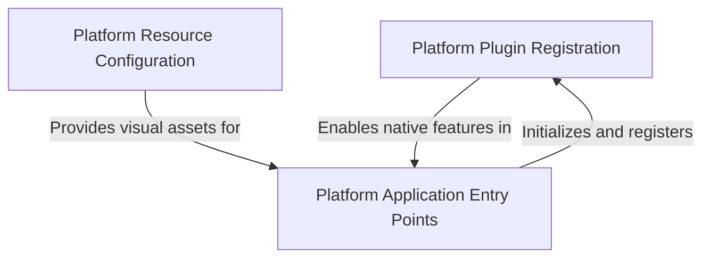

# Tutorial: Public_Safety_Application

This is a **Public Safety Application** built with Flutter, a cross-platform mobile and desktop framework. 
The project is designed to run on *multiple operating systems* including **iOS, Android, Linux, and Windows**. 
The codebase shows the essential *platform-specific scaffolding* that allows Flutter's Dart code to communicate 
with native device features like **file pickers** and **web browsers**. Each platform has its own *entry point* 
and *resource configuration* to ensure the app launches correctly and looks native on every device.

**Source Repository:** [https://github.com/pruthvirajt24/Public_Safety_Application](https://github.com/pruthvirajt24/Public_Safety_Application)

## Chapters

1. [Platform Application Entry Points
](01_platform_application_entry_points_.md)
2. [Platform Resource Configuration
](02_platform_resource_configuration_.md)
3. [Platform Plugin Registration
](03_platform_plugin_registration_.md)
