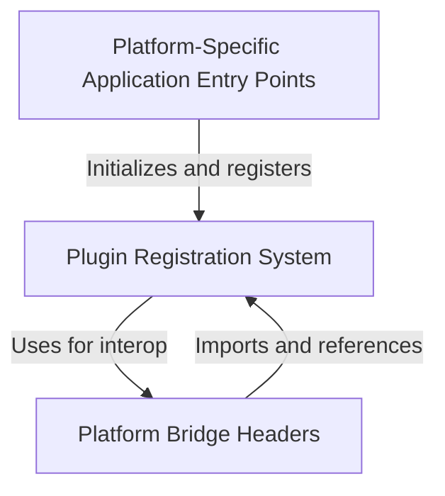

# Tutorial: Public_Safety_Application

This is a **Public Safety Application** built with *Flutter*, a cross-platform framework that allows the app to run on multiple operating systems 
(Linux, Windows, and iOS) from a single codebase. The project consists of **platform-specific entry points** that start the app on different operating 
systems, a **plugin registration system** that connects Flutter's Dart code to native platform features (like opening files or web URLs), and 
**platform bridge headers** that enable different programming languages to communicate with Flutter. Think of it as a *universal app* with specialized 
adapters for each platform it runs on.

**Source Repository:** [https://github.com/pruthvirajt24/Public_Safety_Application](https://github.com/pruthvirajt24/Public_Safety_Application)

## Chapters

1. [Platform-Specific Application Entry Points
](01_platform_specific_application_entry_points_.md)
2. [Plugin Registration System
](02_plugin_registration_system_.md)
3. [Platform Bridge Headers
](03_platform_bridge_headers_.md)
